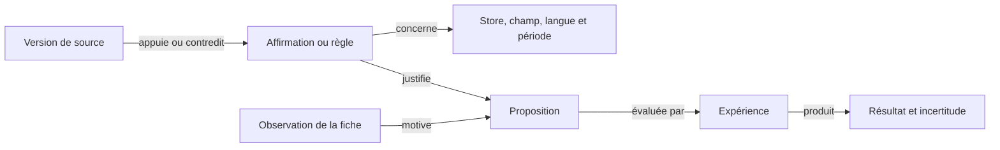

# Architecture de l'alpha

Un monolithe Django modulaire expose une API REST consommée par React et
TypeScript. Les modules partagent une base et des conventions explicites.
Leur séparation ne nécessite pas des microservices au démarrage.

## Cœur et modules

Le cœur gère les comptes, les espaces, les appartenances et le registre.
Chaque module comprend une app Django, un `module.json`, des routes, ses modèles
et éventuellement `frontend/index.tsx`. Le chargement est effectué au déploiement.
L'activation dans un espace ouvre les fonctionnalités déjà installées.

Les dépendances, versions et cycles sont vérifiés au démarrage. Une activation
inclut ses dépendances ; la désactivation d'un module requis est refusée.
L'activation n'exécute pas d'installation Python ou de migration dynamique.
Il n'y a pas de format XML de vues : les vues métier sont des composants React.

Le manifeste distingue `availability: available` (valeur par défaut) de `planned`.
Un module prévu apparaît au catalogue mais ne peut être activé, même par appel API
ou comme dépendance. ASO est disponible avec ses contrôles déterministes Apple.
Les états Enabled/Disabled décrivent l'activation par espace.

La désactivation retire les accès métier sans supprimer les données importées.
Ainsi, désactiver Connections conserve les fiches dans My apps mais bloque leurs
imports et actualisations. L'interface relit les activations au retour sur un
onglet. Le worker Studio vérifie aussi l'activation sous le verrou de l'espace
avant de démarrer une génération en attente : si Studio est désactivé, elle échoue
sans appeler le fournisseur. Une tâche déjà commencée peut finir ; la désactivation
ne constitue pas une annulation d'un appel externe en cours.

## Données et droits

`User → Membership → Workspace → MobileApp → MetadataSnapshot`

`MobileApp → Brief → GenerationRun → Creative`

Un utilisateur peut appartenir à plusieurs espaces. Les rôles sont owner,
editor et viewer. Seul owner gère les modules et connexions ; viewer ne modifie pas de données.
Toutes les routes métier contrôlent l'appartenance, le rôle et le module actif.
Les UUID ne constituent pas un mécanisme d'autorisation. L'administration Django
est réservée aux administrateurs de l'installation, avec visibilité globale.
L'alpha ne possède pas encore d'interface d'invitation ou de création d'espaces ;
leur administration passe par Django admin ou les commandes Django.

L'isolation s'effectue au niveau applicatif, pas par une base distincte par
client ni par des politiques PostgreSQL RLS. Un module Python installé est du
code de confiance ayant accès au processus et à la base. Le registre n'est pas
une sandbox pour du code tiers malveillant.

## Import et génération

Le connecteur démo fournit des données locales explicitement fictives. Un import
met à jour l'app et crée un instantané si la dernière version diffère. Réimporter
le même contenu à la suite ne le duplique pas ; revenir à une ancienne version
crée un nouvel instantané chronologique.

Le module Apple conserve `Workspace → AppleConnection → AppleAppBinding → MobileApp`.
Chaque connexion possède une clé API chiffrée par l'installation et une révision.
L'appel réseau précède la transaction d'import ; les verrous et la révision empêchent
un import de recréer une connexion supprimée ou d'enregistrer des résultats avec
une clé remplacée. Déconnecter conserve les apps et instantanés mais retire leurs
liens de synchronisation. Les requêtes sont exclusivement GET vers l'API Apple.
Le client vérifie les pages suivantes et limite les délais, tailles et requêtes.
Le connecteur reste synchrone ; les gros imports et tâches planifiées viendront ensuite.

Une génération enregistre le brief et les métadonnées utilisés avant de lancer
la tâche. Le couple espace/request_id protège contre les requêtes répétées ;
une réutilisation avec des entrées différentes donne HTTP 409. La tâche verrouille
son état et ne recrée pas les variantes après une seconde livraison normale.
Les états incluent queued, running, canceling, succeeded, canceled et failed.
Les erreurs sont enregistrées ; le workflow lié fournit l’état de référence.

En local, `run_workflows` traite les tâches depuis la base ; Compose utilise
Redis et Celery. Les exécutions possèdent un bail et un heartbeat. Un worker
interrompu perd le droit d’enregistrer un résultat après expiration de son bail.
Le suivi et le worker local détectent les baux expirés ; la reprise est explicite.

Les trois scripts proviennent de modèles de rédaction déterministes.
Ils sont éditables et exportables. Une modification invalide leur approbation,
même si un client envoie une approbation dans la même requête. Il n'existe encore
ni appel IA dans Studio, ni agent navigateur, ni publication automatique.

## Évolutions prévues

L'audit ASO précède la création de scripts. Ses règles vérifiables par code restent
distinctes des appréciations éditoriales assistées par IA ; chacune conserve sa
source officielle et sa date. Les scripts référencent l'instantané audité de la
fiche, afin que les corrections et les générations restent traçables.

Le socle `panda_store.ai` propose OpenAI (Responses + JSON Schema), Google Gemini
(generateContent + JSON Schema) et Anthropic Claude (outil de réponse structuré).
`AIConnection` conserve la clé chiffrée et un catalogue par fournisseur/espace.
Seul le propriétaire peut connecter, remplacer, actualiser ou retirer une connexion.
Les membres lisent uniquement l’état et le catalogue. Les modèles textuels sont filtrés
par famille ; leur disponibilité effective est confirmée à l’appel, sans repli automatique.
Les endpoints et hôtes sont fixes ; délais et taille des réponses sont bornés. Les erreurs
sont traduites en messages contrôlés sans réponse fournisseur brute ni clé.

La validation réseau des clés précède la transaction de sauvegarde. Un verrou sur
l’espace et une révision attendue empêchent de ressusciter une connexion supprimée
ou d’écraser un remplacement concurrent. Les clés d’environnement ne deviennent pas
implicitement accessibles à tous les espaces. L’interface ASO choisit explicitement
le modèle pour chaque analyse ; il n’existe pas encore de préférence de modèle durable.

Pour Gemini, le catalogue conserve aussi la capacité `thinking` déclarée par l’API
(absente = inconnue). Le module ASO fournit une sélection courte au composant commun :
Gemini 3.8 Flash et Gemini 4 Argon, versions stables avec raisonnement et sortie structurée
selon les fiches Google relues le 16 octobre 2026. Elle est intersectée avec le catalogue
de la clé de chaque espace et exige `thinking: true`. Aucun modèle n’est choisi automatiquement.
« Show other models » donne accès aux autres modèles compatibles, dont les versions Lite,
preview et alias mobiles. Les anciennes connexions doivent actualiser leur catalogue pour
obtenir la nouvelle capacité. Une clé sans modèle suggéré peut toujours afficher les autres.
Cette sélection est un conseil de départ, pas un classement mesuré de qualité ASO ; elle
appartient au module et doit être révisée à l’évolution des modèles.

L’adaptateur envoie explicitement `thinkingLevel: medium` aux deux modèles suggérés,
conformément au défaut documenté ; ce paramètre est obligatoire pour Gemini 4.
La limite de sortie (12 000 tokens pour la revue ASO complète) inclut le raisonnement
chez Gemini et peut interrompre une réponse :
l’analyse échoue alors explicitement sans enregistrer une proposition incomplète ni
relancer un appel payant automatiquement. Les autres modèles gardent leurs réglages
fournisseur par défaut ; notamment, supporter le raisonnement ne signifie pas l’activer
par défaut sur toutes les versions Lite.
Sources : [catalogue Google](https://ai.google.dev/gemini-api/docs/models),
[capacité thinking](https://ai.google.dev/api/models),
[réglages du raisonnement](https://ai.google.dev/gemini-api/docs/generate-content/thinking).

Les futurs agents devront conserver les sources et dates de leurs observations,
les actions effectuées et les coûts. Les connecteurs de stores et réseaux
sociaux auront des interfaces séparées. La veille et la génération peuvent
s'exécuter en tâches ; une publication nécessitera un contenu validé, une
destination explicite et un mécanisme de reprise idempotent.

Les quotas, budgets IA, stockage durable des médias,
facturation et opérations cloud ne font pas partie de cette alpha.

### Retours d’action et erreurs fournisseur

Le client API commun affiche une notification après les mutations confirmées et
leurs échecs. Chaque module peut fournir un libellé explicite via `feedback` ;
les lectures de fond restent silencieuses. L’autosauvegarde des brouillons conserve
son état « Saved » local et notifie ses échecs, sans notification à chaque frappe.
Les copies et exports ont leur propre retour ; « Download started » ne signifie
pas que le navigateur a terminé d’écrire le fichier.

Les réponses de démarrage contenant `workflow_id` sont suivies par le socle tant
que la page reste ouverte, même après navigation dans un autre module. La fin,
l’annulation ou l’échec déclenche un retour unique ; lire un ancien rapport ne
redéclenche pas sa notification. Une interruption réseau du suivi ne marque pas
la tâche comme échouée. Les erreurs restent visibles jusqu’à fermeture, les succès
disparaissent après sept secondes ; cinq notifications au maximum sont affichées.
Cette file est en mémoire, vidée à la déconnexion et au rechargement de page :
ce n’est pas un système de notifications push ou un historique durable. Le statut
et les erreurs des workflows restent consultables dans leur activité enregistrée.

L’adaptateur IA lit une réponse d’erreur bornée à 64 Ko et traduit ses codes en
messages contrôlés : clé refusée, permissions, crédits, plafond de dépenses,
quota, débit, modèle absent, entrée trop grande, indisponibilité ou délai dépassé.
Il conserve l’ambiguïté lorsqu’un `429` ne permet pas de distinguer quota et débit.
Les codes de facturation OpenAI ont priorité sur le type général `insufficient_quota`.
Les anciennes erreurs Claude de crédit/plafond en `400` sont reconnues par des
expressions connues, sans exposer le message brut. `Retry-After` numérique ou daté
est interprété de façon bornée pour conseiller un délai. Aucune requête IA payante
n’est relancée automatiquement ; un timeout peut avoir déjà été facturé.
Les refus de contenu et sorties tronquées ne deviennent pas des recommandations.
Ce traitement réagit aux erreurs réelles ; il ne lit pas le solde des comptes.

Références relues le 16 octobre 2026 :
[OpenAI error codes](https://developers.openai.com/api/docs/guides/error-codes),
[Gemini troubleshooting](https://ai.google.dev/gemini-api/docs/troubleshooting),
[Claude API errors](https://platform.claude.com/docs/en/api/errors).

## Workflows et événements d'exécution

Le socle `panda_store.workflows` est partagé, avec une première intégration dans
Studio. `WorkflowRun`, `StepRun` et `RunEvent` conservent la définition versionnée,
les dépendances, les états, les dates et les événements ordonnés. Studio fige
l'instantané, le brief et le fournisseur dans `GenerationRun`. Les anciennes
générations restent lisibles sans inventer d'événements historiques.

Le parcours actuel est séquentiel : lire les métadonnées et le brief, produire
les trois modèles de scripts, puis les enregistrer pour revue. Un contrat de
module déclare ses étapes et un adaptateur `workflow.RUNNERS` associe une clé et
une version à son exécuteur. Les dépendances sont vérifiées à la création ; le
worker local charge seulement les adaptateurs des packages déjà installés dans
le registre. Le code des modules conserve le modèle de confiance existant.

Les transitions et événements sont enregistrés dans une même transaction sous
verrou de l'exécution. Un jeton de bail protège les écritures contre un worker
ancien ou annulé. Le heartbeat prolonge un bail de 45 secondes toutes les dix
secondes. Une tâche en attente depuis plus de cinq minutes est marquée en échec
lors de sa consultation, avec une indication pour démarrer le worker. Les clients
actifs et le worker local détectent les baux expirés ; il n'existe pas encore de
superviseur périodique autonome pour les exécutions Celery non consultées.

Les routes communes `/api/workspaces/{id}/workflows/{run}/` et `events/` fournissent
respectivement un état paginé et un flux SSE authentifié. Elles vérifient espace,
appartenance et activation du module. Le flux réévalue les accès à chaque lot,
accepte `Last-Event-ID` et conserve des événements ordonnés en base. Il dure au plus
25 secondes ; EventSource se reconnecte, avec polling de secours côté React.
Uvicorn/ASGI et Nginx sans buffering sont configurés pour Compose. Le backend
utilise `CONN_MAX_AGE=0` et les threads de heartbeat ferment leurs connexions à
la sortie. Ce réglage suit les [recommandations Django pour ASGI](https://docs.djangoproject.com/en/5.2/topics/async/#queries-the-orm).
Le serveur
WSGI de développement reste compatible avec un flux synchrone borné. Une coupure
du flux est signalée séparément de l'échec de la tâche.

`Stop` annule immédiatement une tâche en file ou demande un arrêt coopératif
(`canceling`) si elle travaille. La fin de l'appel courant est attendue ; son
résultat est écarté si le bail ou le statut ne l'autorise plus. La sauvegarde des
scripts et la réussite du workflow sont atomiques. Un arrêt ne défait pas une
publication externe et le Studio actuel n'en effectue aucune.

`Retry unfinished steps` crée une tentative liée, conserve la précédente et
réutilise les checkpoints terminés lorsque version, étapes et dépendances
correspondent. Studio reprend les entrées originales, même si la fiche ou le
brief ont changé depuis. Une seule reprise par tentative rend les doubles clics
idempotents. Les checkpoints internes ne sont pas exposés dans l'API d'activité ;
les messages sont des résumés contrôlés, jamais des réponses brutes du fournisseur.
Les scripts produits restent soumis à leur approbation séparée existante.

Le panneau React commun présente les étapes cliquables, leur durée réelle, un
journal horodaté et les commandes permises par le rôle. Il reprend les événements
sans doublons et retire les données si l'accès est révoqué. Il n'allonge pas
artificiellement une génération courte pour simuler une activité d'agent.

Les tests couvrent arrêt en file et pendant un outil, résultats tardifs, reprise
sans nouvelle génération des résultats sauvegardés, curseurs et reconnexion,
accès révoqués, panne de dispatch, worker expiré et flux ASGI. Les doubles
livraisons concurrentes sont aussi vérifiées sur PostgreSQL en CI.

Restent à construire : agents IA et navigateur, ordonnanceur de branches
parallèles, validation humaine suspendant un workflow, contrats de progression
quantifiée et de médias privés, éditeur visuel et supervision autonome de toutes
les tâches. Chaque connecteur avec effets externes devra ajouter idempotence et
réconciliation. Les URLs, captures et coûts seront exposés seulement lorsque
les outils concernés les auront réellement produits.

## Conception de l'agent ASO spécialisé

Le module disponible réalise les contrôles locaux de métadonnées Apple, avec
historique par langue et suivi du workflow commun. `AuditRun` conserve l'import,
la version des règles et le rapport ; les contrôles déterministes restent locaux.
Chaque contrôle conserve ses références et leur date de revue. Le champ
`available_fields` des nouveaux imports distingue une absence de donnée d'une
valeur vide. Les imports antérieurs utilisent uniquement les champs présents.
Une langue absente ne bénéficie jamais d'un repli implicite sur la langue principale.
La reprise garde l'import original ; changer les règles impose de changer leur
version et celle du workflow. Un rapport sauvegardé n'est pas recalculé à la lecture.

Le [catalogue de sources](../addons/aso/knowledge/sources.json) distingue les
références disponibles des [annotations utilisées](../addons/aso/knowledge/editorial.json).
Les contrôles déterministes utilisent les références Apple. La revue IA reçoit
uniquement les annotations explicitement retenues pour ce store et ces champs.

### Revue éditoriale implémentée

Le workflow optionnel `aso.editorial` version 2 ajoute une requête de rédaction,
une validation structurelle puis une seconde requête de contrôle des affirmations
après les règles locales. `AuditRun.inputs` fige fournisseur, modèle demandé, identifiant
et révision de connexion, version d’instructions, critères par champ, limite de sortie
et annotations sourcées avec leur version.
La version du contrôle des affirmations et son plafond de sortie sont également
figés. L'interface annonce jusqu'à deux appels facturés avant le lancement.
Le rapport conserve le modèle résolu et les tokens retournés. Les checkpoints de
réponse et de validation permettent une reprise sans rappeler un modèle ayant déjà
répondu. Une réponse perdue avant sauvegarde peut être facturée à nouveau lors d’une
reprise explicite ; aucune garantie d’exactly-once sur l’API tierce n’est annoncée.
Le heartbeat maintient le bail pendant le réseau. Annuler écarte les résultats tardifs
mais n’annule pas une facture déjà engagée. Retirer/remplacer la clé avant l’appel
fait échouer cette tentative, sans basculer vers une autre clé ou un autre fournisseur.

La validation impose langue disponible, champs supportés, citations présentes dans
l’import, références autorisées, limites de texte, absence de doublons, nouveaux
nombres ou changements d’URLs. Elle ne prouve pas la fidélité des promesses, la bonne
interprétation des sources ou la valeur commerciale : toutes les propositions IA
sont marquées hypothèses à relire. Elles peuvent alimenter un brouillon, jamais
écrire chez Apple. Les règles, l’activité et le rapport historique restent distincts.
Le corpus courant contient cinq annotations de méthode : deux guides Apple, le
cadre ASO de Phiture, la méthodologie de recherche de mots-clés AppTweak et celle
d'expérimentation SplitMetrics. Trois observations de fiches publiques complètent
la revue du nom, du sous-titre et de la description : Duolingo, Spotify et Tinder.
Chaque annotation porte son champ d'application,
son store, sa date de revue, le type de source et ses limites. Les seuils chiffrés
et affirmations algorithmiques non corroborés ne sont pas ingérés. Le catalogue
plus large inclut des références Google et des études de cas qui ne sont pas
envoyées au modèle. La recherche en direct et le graphe restent à faire. La revue
des images fonctionne dans un workflow séparé décrit plus bas.

Depuis `apple-editorial-2026-10-17.2`, chaque avis ou proposition doit citer au
moins une référence officielle applicable ; une méthodologie de prestataire ne
peut pas être sa seule autorité. Les citations hors champ ou hors store sont
écartées. Ce contrôle structurel ne prouve pas que le modèle interprète bien la
source. Le serveur conserve l'annotation exacte sur les citations acceptées.
Les versions précédentes restent validables avec leurs propres notes sauvegardées.

Le transport IA possède une échéance totale de 300 secondes par génération,
configurable par installation via `PANDA_AI_TIMEOUT_SECONDS` (30 à 900 secondes).
Un client HTTPX asynchrone dans une boucle temporaire permet à `asyncio.timeout`
d'interrompre aussi une attente du premier octet ou un corps reçu très lentement.
L'interface Python reste synchrone pour les vues et workers ; aucun accès ORM
n'est effectué dans cette boucle. Les limites HTTPX de connexion, écriture et
pool restent courtes. Le catalogue conserve son délai de lecture de 70 secondes
et une échéance totale de 90 secondes. Les limites Celery de l'audit sont calculées
pour deux échéances de génération, plus 60/90 secondes de marge. Backend et worker
doivent être redémarrés après un changement de configuration.

Cette correction fait suite à un audit Gemini 4 Argon interrompu localement après
70 secondes avant sa première réponse. Elle conserve les plafonds de sortie,
la vérification des affirmations et l'absence de relance payante automatique.
Google décrit la latence supplémentaire du raisonnement dans son
[guide de dépannage](https://ai.google.dev/gemini-api/docs/troubleshooting).
HTTPX distingue le délai d'inactivité de lecture d'une échéance globale dans sa
[documentation des timeouts](https://www.python-httpx.org/advanced/timeouts/).
La reprise réelle du même audit `fr-CA` avec Gemini 4 Argon a terminé en 32 secondes
après la correction, en réutilisant les étapes de lecture et de règles. Cet essai
confirme le parcours de reprise ; sa réponse plus rapide ne prouve pas à elle seule
le comportement au-delà de 70 secondes. Les tests du transport vérifient le budget
configuré, l'interruption avant le premier octet ou pendant le corps, la fermeture
de la connexion et l'absence de requêtes automatiques supplémentaires.

Depuis `apple-editorial-2026-10-17.3`, `grounding.py` examine séparément les
observations, titres, justifications et remplacements après validation structurelle.
Le même fournisseur et modèle est appelé avec une consigne de vérification dédiée,
le texte importé, les annotations, les résultats des règles locales et les candidats
exacts, sans attentes du benchmark. Les propositions générées ne peuvent pas servir
de preuves à elles-mêmes.
Le contrôle distingue notamment stockage local, absence de compte, fonctionnement
hors ligne, fonctionnalités décrites et comportement vérifié. Les qualifications
de paiement, confidentialité, réseau et périmètre doivent conserver leur sens.

Chaque candidat doit recevoir un verdict `supported`, `unsupported` ou `uncertain`.
Un refus cite un passage exact du candidat ; les identifiants doivent couvrir
exactement tous les candidats, sans doublon. Le résultat est lié au contexte par
empreinte SHA-256. Un contrôle absent, incomplet ou détaché de son contexte échoue
sans publier les recommandations. Une observation non étayée est remplacée par un
message serveur et bloque aussi sa proposition ; une proposition refusée disparaît
des changements proposés. Le motif généré par le vérificateur reste dans le
checkpoint et n'est pas réaffiché comme une nouvelle affirmation fiable.

L'étape `Check claims against listing` possède son checkpoint ; une reprise ne
refait que les étapes inachevées. Les clés sont revérifiées avant chacun des deux
appels, et une annulation écarte tout résultat tardif. Les tokens des deux appels
sont distincts. Ce filtre utilise un modèle, pas une preuve indépendante : ses
faux positifs et faux négatifs doivent être évalués. Sept cas de régression
reproductibles comprennent les deux réponses fautives observées et des contrôles
positifs/négatifs sur les mêmes notions. Les rapports historiques ne sont pas
réécrits et indiquent qu'ils précèdent cette étape.

L'onglet `Sources` sépare les notes de l'audit sélectionné de la bibliothèque pour
les prochains audits. `GET /api/workspaces/{id}/aso/knowledge/` fournit cette
dernière aux membres d'un espace où ASO est activé, y compris en lecture seule.
La lecture des audits renvoie leurs notes sauvegardées et ne les remplace jamais
par le catalogue courant. Les dates des règles locales restent indépendantes des
dates de revue des annotations. Aucun appel fournisseur n'est fait pour consulter
les sources.

Pour contribuer : vérifier l'article original, ajouter une synthèse courte avec
ses limites et son périmètre dans `knowledge/editorial.json`, puis changer la
version du corpus et des instructions. Mettre à jour les tests de périmètre,
exécuter l'évaluation et redémarrer les processus serveur/worker. Un lien ajouté
seulement à `sources.json` n'est pas une instruction active pour l'agent.

Depuis les instructions `apple-editorial-2026-10-16.3`, chaque nouveau rapport IA
demande une observation sur les cinq champs : nom, sous-titre, description, texte
promotionnel et mots-clés. Chaque avis conclut à l’absence de changement utile,
à une amélioration possible ou à un manque de preuves. Les champs non importés sont
signalés par le serveur, jamais considérés comme analysés. Une citation du champ est
requise s’il contient du texte ; une référence ou citation invalide rend cet avis
indisponible et bloque sa proposition. Le rapport affiche le nombre d’avis validés.
Un avis sans changement n’est ni une note ASO ni une vérification des fonctionnalités.

Le modèle peut proposer jusqu’à cinq changements, un par champ, uniquement s’il a
justifié une amélioration dans l’avis correspondant. Un champ importé vide peut être
complété à partir de preuves présentes dans les autres champs. L’interface affiche
les avis et propositions sous « Content review », puis les règles Apple, dont les
limites sont libellées « Within limit ». Les anciens rapports restent inchangés et
indiquent qu’une nouvelle analyse est nécessaire pour obtenir la couverture par champ.
Le validateur garde la lecture des anciens checkpoints sans leur inventer d’avis.

Depuis les instructions `apple-editorial-2026-10-17.1`, les mêmes
exigences de preuve s'appliquent aux observations et aux justifications : le stockage local
ne démontre pas un fonctionnement hors ligne, et un nom lisible ne démontre pas
son unicité sur le marché. Les checkpoints de la version précédente conservent
leurs cinq avis lors de la validation.

Le [banc d'évaluation](aso-evaluation.md) utilise exactement le contexte et
l'adaptateur de production, avec dix fiches synthétiques. Les contrôles de sortie
sont distincts de la revue éditoriale humaine. Les attentes ne sont jamais envoyées
au modèle. Les rapports enregistrent les entrées, versions, réponses et échecs ;
une réévaluation explicite conserve les anciens critères et n'effectue aucun appel IA.

Références d’implémentation : [OpenAI Structured Outputs](https://developers.openai.com/api/docs/guides/structured-outputs),
[Gemini generateContent](https://ai.google.dev/api/generate-content),
[Claude Messages](https://platform.claude.com/docs/en/api/messages/create).

### Brouillons implémentés

`ListingDraft` conserve une référence importée immuable, une langue, le contenu
éditable et les propositions sources sélectionnées. Un brouillon peut venir d'un
import, d'une proposition d'audit terminée ou d'une copie nommée d'un brouillon.
`DraftRevision` conserve chaque sauvegarde, son auteur, sa raison et son contenu.
Les mutations exigent la version attendue et un identifiant de requête : un conflit
retourne 409 ; rejouer la même requête ne crée pas une seconde révision. Le verrou
de l'espace puis celui du brouillon sérialisent les mutations sur PostgreSQL.

La sauvegarde différée du frontend ne remplace pas les frappes intervenues pendant
une requête. Un garde de navigation attend la sauvegarde avant de changer de module,
d'app, d'espace ou de se déconnecter. En cas d'échec, le texte reste à l'écran avec
une action de reprise ; en cas de conflit, on peut le copier puis charger la version
enregistrée. Le statut `ready` exige une action séparée et des limites de champs
résolues, y compris la divergence octets/caractères ; une modification le réinitialise.

La comparaison lit le dernier import de la langue exacte, sans repli ni réécriture
du brouillon. L'actualisation Apple passe par le connecteur existant et ses contrôles
de droits/activation. Les champs modifiés peuvent correspondre au dernier import,
sans changement de statut de revue et sans déduction de publication ou de performance.
Les exports texte utilisent une révision explicite. Aucun endpoint ne publie sur Apple.

### Connaissances et preuves

La spécialisation doit couvrir découverte, intentions de recherche, mots-clés,
conversion, visuels, localisation, avis, expérimentation et mesure. Elle repose sur
des outils métier, des sources consultables et des évaluations. Une connaissance
du modèle seul ne suffit pas à justifier une règle, statistique ou promesse produit.

Les sources sont sélectionnées au niveau de l'article et de l'affirmation :

- Apple et Google : exigences et recommandations classées séparément, avec leur portée.
- Phiture / ASO Stack : cadre de travail et méthodes de praticiens.
- AppTweak : recherche de mots-clés et distinction entre observations, données de
  comptes connectés et estimations propriétaires.
- SplitMetrics : conception d'expériences et cas clients contextualisés. Un test
  sur une page simulée avec trafic publicitaire n'est pas une mesure native
  d'installations organiques.
- Fiches de grandes apps et concurrents comparables : observations datées, sans
  prétendre connaître leurs taux de conversion ou mots-clés privés.
- Données et expériences de l'app : résultats isolés par workspace et liés à un instantané.

La réputation d'une société n'approuve pas toutes ses affirmations. Conserver
éditeur, auteur disponible, URL, dates, store, pays, langue, contexte, type de preuve
et limites. Les résultats commerciaux restent attribués à leur auteur. Les chiffres
sans méthode et contradictions restent à vérifier. Une référence ancienne peut
illustrer une méthode sans décrire les stores actuels. Un article inaccessible
n'est jamais résumé comme s'il avait été lu.

Le catalogue distribué contient liens et annotations originales. L'indexation
future respecte les autorisations d'accès et de réutilisation ; aucune copie
intégrale de blogs tiers n'est redistribuée. Les règles évoluent avec historique.

### Recherche sur trois fiches de référence

Exigence pour chaque future recherche ASO enrichie : ouvrir les fiches publiques
de trois apps connues dans trois domaines différents et parcourir leurs textes
et galeries disponibles. Une liste de noms, un résultat de recherche ou le souvenir
du modèle ne constitue pas une consultation. Ce regard transversal complète une
recherche de concurrents pertinents pour la niche ; il ne la remplace pas.

La [première revue manuelle](../addons/aso/knowledge/visual-research.json) du
17 octobre 2026 porte sur Duolingo, Spotify et Tinder : App Store américain,
texte anglais et galerie iPhone, parcourue jusqu'à sa fin dans le navigateur.
Elle conserve des observations originales et des liens, sans redistribuer les
images. Le téléchargement des assets ayant été refusé, aucune copie ni empreinte
des images n'est archivée. Ce fichier conserve la recherche d'origine.
Depuis `aso-knowledge-2026-10-17.2`, trois annotations textuelles sélectionnées
dans `editorial.json` sont utilisées dans les nouveaux audits IA et
visibles sous « Public listing examples » dans Sources. Les observations visuelles
restent hors du contexte IA. Les audits antérieurs gardent leurs propres notes.

Les instructions de rédaction `.5` et de contrôle des affirmations `.3` distinguent
ces exemples datés des règles et des fonctionnalités de l'app auditée. Ils peuvent
inspirer une structure pertinente, sans transfert de marque, de fonction ou de
promesse, ni recherche de mots-clés. La validation exige toujours une source
officielle applicable et refuse une citation de ces exemples pour les mots-clés
ou le texte promotionnel. Le contexte d'observation accompagne les citations
acceptées. Les deux appels reçoivent les mêmes notes sauvegardées ; l'activité
indique leur nombre et l'absence de recherche web en direct. Six cas synthétiques
supplémentaires évaluent les transferts injustifiés et une analogie acceptable.

Le futur workflow devra :

- Ouvrir ou revérifier les pages à chaque recherche ; conserver URL, date, store,
  pays, langue, appareil et couverture réelle. Une version d'app observée ne date
  pas ses captures. Une note ancienne ne devient pas une observation actuelle.
- Examiner nom, sous-titre ou description courte, structure de description,
  message des captures, interface montrée et ordre de la galerie. Ne pas déduire
  des mots-clés Apple privés à partir de la fiche publique.
- Afficher les pages consultées dans l'activité et la couverture obtenue sur les
  trois références. Une page inaccessible ou une galerie partielle reste signalée ;
  une observation manquante n'est jamais inventée pour atteindre trois.
- Séparer règles officielles, recommandations officielles, méthodes de praticiens,
  observations publiques et résultats d'expériences. Conserver les contradictions
  et les conditions de paiement, de marché ou de disponibilité.
- Justifier la pertinence de chaque exemple pour l'app auditée et formuler une
  hypothèse testable. Ni la notoriété, ni une interface visible ne prouvent une
  hausse de conversion, la conformité ou le fonctionnement réel d'une feature.
- Figer les notes utilisées avec l'audit et rendre leurs sources consultables.
  Avant injection, évaluer les confusions entre exemple et règle, les transferts
  entre stores/langues, les promesses inventées et les instructions présentes
  dans les pages. Le choix du modèle et les accès restent propres à l'installation.

Pour les captures, la revue préparatoire couvre les règles Apple sur les
métadonnées, ses spécifications et conseils de présentation, puis les exigences et
recommandations Google sur les assets. Phiture fournit une méthode d'itération
historique ; les conseils AppTweak sont retenus par affirmation après recoupement.
Par exemple, son conseil général d'ajouter des CTA doit être restreint par la
recommandation Google d'éviter les invitations à installer dans les captures.
L'agent ne doit pas absorber un article entier au seul motif de la réputation de
son éditeur. Les méthodes de mesure restent distinctes des observations visuelles.

### Graphe de connaissances et recherche documentaire

Le graphe proposé relie chaque proposition à ses preuves :

Des tables Django compatibles SQLite et PostgreSQL suffisent pour commencer ;
aucun service de graphe supplémentaire n'est obligatoire pour l'auto-hébergement.
Chaque relation conserve origine, portée et statut de vérification. Une proximité
sémantique n'est pas une relation causale. Les liens proposés par l'IA doivent être
vérifiés avant leur utilisation comme preuve.

La recherche filtre d'abord par store, langue, marché, période et fonctionnalité,
puis retrouve les documents et suit les liens vers les sources, contradictions et
expériences applicables. Recherche textuelle puis sémantique facultative : les
embeddings ne remplacent pas les filtres et preuves. Les concepts sont réutilisables ;
les résultats privés restent limités au workspace. Les apports communautaires passent
par revue des sources et tests et ne deviennent pas des instructions exécutables.

### Exécution et validation

Vérifier d'abord la couverture : version, langues, captures par langue et appareil,
marché cible, fonctions confirmées et statistiques disponibles. L'import actuel
ne couvre que les captures de la langue principale ; une autre langue non importée
ne prouve donc pas un défaut de la fiche.

Le parcours prévu : collecte, contrôles déterministes, recherche documentaire et
concurrentielle, propositions contextualisées, validation, protocole de mesure.
Les contrôles déterministes fonctionnent sans clé IA ; l'analyse éditoriale utilise
le fournisseur et modèle choisis. Les pages et documents sont des données non
fiables, jamais des instructions pour l'agent.

Une proposition conserve l'instantané, le champ, le constat, les références exactes,
le remplacement, les conditions d'application, le statut (correction vérifiable,
hypothèse à tester ou données insuffisantes) et la méthode de validation. Le validateur
rejette références inexistantes, contraintes dépassées, fonctions inventées et
statistiques sans source. Il distingue pertinence d'un terme, demande mesurée et
estimation tierce. Les connecteurs de données payants restent facultatifs.

Avant activation, évaluer sur des cas relus par un humain : fiches correctes sans
correction forcée, données incomplètes, stores différents, langues non couvertes,
sources obsolètes ou contradictoires, absence de statistiques, promesses non
confirmées et contenus tentant de détourner l'agent. Vérifier citations, portée
des règles, utilité des propositions et abstention pour chaque fournisseur.
Les évaluations du modèle ne remplacent pas la mesure des gains sur le store.

### Revue des captures importées

`AuditRun.inputs.mode = screenshots` sélectionne `aso.visual` version 1. Le parcours
comprend `listing`, `images`, `visual`, `verify_visual`, `report`. Il utilise le
modèle choisi, deux appels et les mêmes révisions de connexion, délais, notifications,
permissions et reprises que l'audit texte. Les audits texte gardent leurs contrats.
La version des instructions visuelles est gelée dans les entrées et contrôlée avant
un appel. Une reprise conserve les images et appels terminés ; une réponse perdue
ou invalide peut nécessiter un nouvel appel facturé, jamais lancé automatiquement.

`images.py` ne lit que les URL de l'instantané appartenant à l'app du workspace.
Seuls les hôtes HTTPS `isN-ssl.mzstatic.com` sont admis, sans identifiants ni port
alternatif ni redirection. Limites : dix images, 8 MB téléchargés par image,
12 secondes par téléchargement et 45 secondes pour le lot, 20 millions de pixels,
formats PNG/JPEG/WebP non animés. Pillow prépare un JPEG sans métadonnées, de côté
maximal 2048 px et de taille maximale 1,5 MB. Les dimensions téléchargées ne sont
pas celles des originaux App Store Connect et ne valident pas les spécifications.

`ScreenshotEvidence` conserve ces octets en base et leur empreinte. Ce compromis
initial fonctionne avec SQLite ou PostgreSQL et évite une configuration de fichiers
partagés entre worker et API. Coût maximal : 15 MB par nouveau lot, sans politique
de purge automatique. La suppression de l'audit parent supprime ses images ; les
reprises référencent les images du premier audit. Une future purge doit donc tenir
compte de ces références. L'API d'image vérifie l'appartenance au workspace et
l'activation du module, avec cache privé désactivé. Aucun octet d'image n'apparaît
dans les réponses d'historique ou les événements du workflow.

Les formats officiels des trois transports sont documentés ici :
[OpenAI Responses](https://developers.openai.com/api/docs/guides/images-vision),
[Gemini Generate Content](https://ai.google.dev/gemini-api/docs/generate-content/image-understanding),
[Claude Messages](https://platform.claude.com/docs/en/build-with-claude/vision).
Les mêmes octets et identifiants d'image accompagnent les deux appels. Aucun modèle
alternatif n'est appelé automatiquement. Les erreurs d'accès, quota, délai ou
incompatibilité remontent dans le workflow existant.

La revue reçoit cinq notes applicables à l'App Store et les trois observations
visuelles datées de Duolingo, Spotify et Tinder. Les notes Google sont exclues.
Le premier appel décrit chaque image et peut suggérer un changement ; le second
revoit constat, extrait visible, interprétation de règle et recommandation contre
les mêmes images, la fiche et les références. Une réponse incomplète ou incohérente
échoue avant publication ; une conclusion non étayée ou incertaine est masquée.
L'empreinte du contexte empêche de réutiliser une vérification pour d'autres
candidats. Cette vérification probabiliste ne remplace pas une relecture humaine.

La langue doit correspondre exactement aux captures importées. Les appareils,
images indisponibles et éventuelles images au-delà de la limite sont affichés.
Ni l'ordre importé ni le nom du fichier ne prouvent l'ordre de la galerie en ligne.
Les observations publiques restent des notes de recherche manuelle ; aucune copie
des images des trois références n'est téléchargée et aucun navigateur autonome
n'intervient dans ce workflow. Il n'édite ni ne publie les captures.

### Briefs de captures

Une recommandation visuelle conservée (`reviewed`, `improve`, texte non vide) peut
créer un `ScreenshotBrief` depuis l'audit terminé de la même app. Les constats
écartés, images indisponibles et évaluations sans changement ne peuvent pas créer
un brief. Aucune requête IA ni tâche facturée ne se déclenche : le serveur reprend
le constat existant, remplace ses identifiants d'image par les noms de fichier,
et conserve une copie de la fiche et des sources utilisées. Le brief appartient
au module ASO ; Studio peut être désactivé sans affecter ce parcours.

Le contenu éditable comprend le changement, l'écran ou état à capturer, un éventuel
texte de surimpression et une hypothèse de test. La référence `ScreenshotEvidence`
est partagée sans recopier ses octets. La suppression de l'audit source met cette
référence à NULL ; le brief et ses notes survivent, et l'interface indique l'image
manquante. Une nouvelle importation ou un audit ne modifient pas un brief existant.

`ScreenshotBriefRevision` enregistre contenu, statut, auteur, date et opération.
Création et modification utilisent des identifiants idempotents. Le verrou de
workspace et le numéro de version empêchent d'écraser une autre session. Une
réponse perdue se relit avec le même identifiant ; une ancienne opération après
une modification ultérieure renvoie un conflit. Dupliquer crée un brouillon
indépendant. Restaurer ajoute une révision et remet le statut en brouillon.

Le passage à `ready` exige le changement et l'écran renseignés, et une confirmation
explicite des affirmations produit par un membre autorisé. Il n'est pas combinable
avec une modification du contenu dans la même requête. Toute modification réelle
réinitialise ce statut. La révision conserve l'auteur et la confirmation ; il ne
s'agit ni d'une vérification du fonctionnement de l'app par Panda Store ni d'une
approbation du store. Les lecteurs peuvent consulter et exporter ; seuls owners
et editors peuvent créer, modifier ou marquer prêt. Désactiver ASO ferme ces API.

L'export ZIP prend une révision précise et des noms de fichiers fixes (`brief.md`,
`brief.json`, `reference.jpg`). Il inclut la référence privée du workspace et les
limites des sources ; il ne contacte aucun store et ne télécharge pas une nouvelle
image. Aucun fichier arbitraire du système n'est ajouté. L'UI sauvegarde avant
export, duplication et navigation, garde les modifications locales lors d'un
conflit et réutilise une requête dont le résultat était incertain.

### Veille avant création dans Studio

`ResearchRun` fige l'import, le sujet, le marché, le fournisseur/modèle et la révision
de connexion. Le workflow `studio.research` suit six étapes : contrôle du navigateur,
découverte web, consultation des sources, analyse, vérification séparée, rapport.
Il utilise le même journal durable, l'annulation coopérative et les reprises que l'ASO.
La création IA exploite ensuite une sélection explicite de ces observations ; les modèles
locaux restent un mode de démonstration séparé. La veille ne modifie ni les fiches stores ni les comptes sociaux.

Les adaptateurs de découverte utilisent les outils officiels
[OpenAI Web search](https://developers.openai.com/api/docs/guides/tools-web-search),
[Google Search grounding](https://ai.google.dev/gemini-api/docs/generate-content/google-search)
et [Claude Web search](https://platform.claude.com/docs/en/agents-and-tools/tool-use/web-search-tool),
consultés le 17 octobre 2026. Les URLs candidates proviennent des métadonnées des
outils, jamais d'une URL inventée dans le texte du modèle. Les réponses narratives
de recherche ne sont pas utilisées comme observations. Les liens de redirection de
Google sont résolus uniquement sur son endpoint documenté, puis la page de destination
subit les contrôles habituels. Les suggestions Google sont affichées dans une iframe
sandboxée sans scripts, formulaires ni accès à l'origine de l'application.

Un processus Chromium éphémère ouvre au maximum six sources découvertes et les trois
références Duolingo, Spotify et Tinder. Il capture le premier écran, fait défiler d'un
écran partiel et capture une seconde vue. `ResearchPage` conserve le texte borné,
les JPEG, les empreintes, les dates, les URLs et les actions effectivement réalisées.
Ce parcours n'est pas une exploration illimitée, une lecture de carrousel complet ni
une analyse vidéo/audio. Les pages bloquées, incomplètes et les références manquantes
sont visibles ; une réussite de workflow ne signifie pas couverture complète.

Le navigateur reçoit un environnement minimal, un HOME temporaire, aucun cookie
personnel et aucune clé fournisseur. Son sandbox Chromium reste activé. Les requêtes
GET passent par un relais HTTPCore qui résout chaque hôte, refuse toute adresse privée
ou réservée et connecte l'IP contrôlée en gardant le nom TLS d'origine. Le navigateur
a un proxy fermé, sans contournement loopback ; il ne peut pas utiliser un chemin réseau
direct si le relais refuse. Les robots des pages destinations sont vérifiés. Les
services workers, WebSockets, médias, formulaires et frames sont bloqués. Les captures
sont accessibles seulement aux membres de l'espace si Studio est actif.

Chaque page a un délai externe de 65 secondes, un budget réseau de 20 Mo et 120 requêtes,
avec des bornes par réponse et capture. L'annulation tue le groupe du processus navigateur.
Ces limites et le sandbox ne remplacent pas l'isolation de déploiement nécessaire à une
offre cloud : ses workers et quotas restent un chantier distinct. Docker utilise le
profil seccomp Playwright fourni et un utilisateur non root, sans désactiver le sandbox.

L'analyse reçoit seulement les pages observées et deux vues au maximum par page.
Les citations textuelles et métriques doivent être retrouvées dans le texte archivé.
Une seconde analyse vérifie les constats contre les mêmes preuves. Les résultats
retenus restent des observations IA à relire, pas des mesures de conversion. Aucune
note de viralité ou causalité sur les installations n'est calculée. Les références
transversales ne sont pas des concurrents supposés. Le texte des pages reste une donnée
non fiable et ne donne aucune instruction au navigateur ni au worker.

La reprise après échec réutilise les étapes terminées et les pages déjà archivées.
Après une réussite partielle, `Retry unavailable sources` conserve la découverte,
copie les pages lisibles avec leurs dates, empreintes et références d'origine, puis
retente seulement les sources manquantes dans une nouvelle exécution. L'analyse et
la vérification peuvent être facturées à nouveau. Le rapport d'origine est conservé.
La consommation enregistrée dans une étape réutilisée vient de la tentative d'origine ;
le journal indique sa réutilisation, ce n'est pas un nouvel appel facturé.

### Création IA depuis la veille

Le brief conserve une session `ResearchRun` et un à trois identifiants de pages dont
les observations ont été retenues. Le serveur vérifie l'app, l'espace, le statut terminé
et l'existence des preuves ; aucun extrait envoyé par le client n'est accepté comme
source. `Use observations in brief` sauvegarde cette sélection avec les éditions locales
du brief puis ouvre Scripts. Les observations de veille restent des hypothèses.

`POST apps/{app}/ai-runs/` reçoit un identifiant de requête, l'import choisi, le brief
explicite, la sélection et le modèle. La confirmation des faits produit est requise et
datée avec l'auteur. Il s'agit d'une déclaration de l'auteur, pas d'un test fonctionnel
effectué par Panda Store. La requête normalisée et les entrées sont figées dans
`GenerationRun`, avec la révision de connexion. Une réponse perdue peut être récupérée
sans consulter un nouvel import ou une nouvelle clé ; une réutilisation de l'identifiant
avec un contenu différent est refusée. Une génération active par espace est autorisée.

Le workflow `studio.ai_scripts` vérifie le contexte, écrit trois scripts, effectue une
seconde revue et sauvegarde les sorties. Les adaptateurs structurés existants sont
réutilisés pour les trois fournisseurs. Le format suit la
[documentation officielle OpenAI sur les sorties structurées](https://developers.openai.com/api/docs/guides/structured-outputs),
consultée le 17 octobre 2026 ; un schéma valide ne garantit pas un contenu correct.
Les variantes, limites de champs, références connues, citations de faits produit et
doublons exacts sont contrôlés par le code. Le vérificateur relit aussi les affirmations
omises de la liste de preuves, les scènes, la langue, la durée cible et la différence des angles.
La revue sémantique peut manquer des erreurs ; elle ne vaut ni validation humaine,
ni conformité à une politique publicitaire, ni preuve de performance.

Une revue qui rejette un script conserve ses motifs mais n'enregistre aucun `Creative`.
Le brief doit être ajusté avant une nouvelle génération ; ce rejet ne peut pas être
rejoué par Retry. Un incident fournisseur peut reprendre les étapes terminées sans
réécrire les scripts, avec le même modèle et contexte. Les appels n'ont pas de reprise
payante automatique. Les écritures finales et l'activité sont protégées par le jeton
d'exécution ; une réponse arrivée après annulation ne peut pas enregistrer de scripts.

Chaque Creative garde la justification et les preuves originales dans `provenance`.
Les éditions humaines ne réécrivent pas cet historique et remettent l'approbation à faux.
L'export indique le modèle, les faits confirmés, les sources et l'état de revue. Les
scripts décrivent un tournage à réaliser : aucun média n'est produit ou publié par ce workflow.
Le mode `demo_templates` et son ancien workflow restent disponibles séparément.
