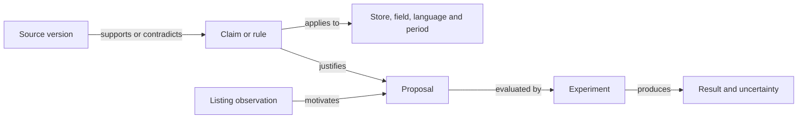

# Alpha architecture

A modular Django monolith exposes a REST API consumed by React and TypeScript.
Modules share a database and explicit conventions. Their separation does not
require microservices at the outset.

## Core and modules

The core manages accounts, workspaces, memberships and the registry. Each module
includes a Django app, `module.json`, routes, models and optionally
`frontend/index.tsx`. Loading happens at deployment. Activation in a workspace
opens access to features already installed.

The first public community release focuses on two business modules: **ASO and SMM**.
The catalogue, Apple, Google Play and AI connections, and workflows provide their
foundation. The example module supports extension development and stays hidden in
navigation and the Modules screen. Social connections for publishing, sending and
scheduling are reserved for the future cloud edition; the research browser connector
is part of community SMM. The [release criteria](roadmap.md#next-milestone) cover
installation, reliability, editing and exports.

Dependencies, versions and cycles are checked at startup. Activation includes
dependencies; disabling a required module is rejected. Activation does not run
Python installations or dynamic migrations. There is no XML view format: business
views are React components.

The manifest distinguishes `availability: available` (the default) from `planned`.
A planned module appears in the catalogue but cannot be activated, even through
the API or as a dependency. ASO is available with deterministic Apple checks.
Enabled/Disabled states describe activation per workspace.

Deactivation removes feature access without deleting imported data. For example,
disabling Connections preserves listings in My apps but blocks imports and refreshes.
The interface reloads activation state when returning to a tab. The SMM worker also
checks activation under the workspace lock before starting a queued generation:
if SMM is disabled, it fails without calling the provider. A task already started
may finish; deactivation does not cancel an external call in progress.

## Data and permissions

`User → Membership → Workspace → MobileApp → MetadataSnapshot`

`MobileApp → Brief → GenerationRun → Creative`

A user can belong to multiple workspaces. Roles are owner, editor and viewer.
Only owners manage modules and connections; viewers cannot modify data. All
business routes check membership, role and module activation. UUIDs are not an
authorization mechanism. Django administration is reserved for installation
administrators, with global visibility. The alpha has no invitation or additional
workspace creation interface yet; administration uses Django admin or Django commands.

Isolation is enforced at the application level, not through a separate database
per customer or PostgreSQL RLS policies. An installed Python module is trusted
code with process and database access. The registry is not a sandbox for malicious
third-party code.

## Import and generation

The demo connector supplies explicitly fictional local data. An import updates
the app and creates a snapshot if the latest version differs. Reimporting the same
content consecutively does not duplicate it; returning to an earlier version
creates a new chronological snapshot.

The Apple module stores `Workspace → AppleConnection → AppleAppBinding → MobileApp`.
Each connection has an API key encrypted by the installation and a revision.
The network call precedes the import transaction; locks and the revision prevent
an import from recreating a deleted connection or saving results with a replaced
key. Disconnecting preserves apps and snapshots but removes synchronization bindings.
Requests are exclusively GET calls to Apple's API. The client validates pagination
and bounds time, size and request counts. The connector remains synchronous;
large imports and scheduled tasks are future work.

Connections retains the technical identifier `apple_store` to preserve existing
installations. The `addons/apple_store/google_play` subpackage adds
`Workspace → GooglePlayConnection → GooglePlayAppBinding → MobileApp`, under
`apple_store/google-play/` routes. Android listings keep their short description
separate from Apple's subtitle. Snapshots use `google_play.api` and synchronization
uses `google_play`; the interface directs the latter to its matching connector.

Google Play requires a temporary edit session to read a copy of the deployed listing.
The client allows only the OAuth exchange, session creation, supported reads and
session deletion. It rejects redirects and publishing. A dedicated service account
avoids invalidating another tool's session. `GooglePlayLease`, shared across
workspaces and expiring after 90 seconds, prevents simultaneous imports for that
account in the installation. Imports have a 40-second budget and a separate bounded
cleanup. A changed revision or deleted connection during reading prevents results
from being saved.

The interface imports one app at a time. Apple provides the selected account's
catalogue; Google Play requires the package name because its API does not provide
a complete catalogue. Accounts and keys are managed in Connections, selection and
import in My apps.

### Projects without a store listing

`MobileApp.origin=project` distinguishes an idea or app in development from an import.
The catalogue accepts a typed, pasted or Markdown-imported description of up to
20,000 characters, with an audience and features declared as implemented. Edits
create snapshots; research and analyses retain the one used at startup in
`app_context`. No store account or prewritten listing is required.

SMM receives the full description and confirmed scope of up to 4,000 characters.
ASO proposals and SMM adaptations prepare publication copy in the present tense,
based on documented features. The internal project stage does not become a mandatory
advertising disclaimer. Open questions and required media stay outside audience-facing
copy. This convention permits no invented features, fake testimonials or results,
or claims of store availability. Writing and verification use the same convention.

### Generations

A generation records the brief and metadata used before starting its task.
The workspace/request_id pair protects against repeated requests; reuse with
different inputs returns HTTP 409. The task locks its state and does not recreate
variants after a normal second delivery. States include queued, running, canceling,
succeeded, canceled and failed. Errors are recorded; the linked workflow supplies
the authoritative state.

Locally, `run_workflows` processes tasks from the database; Compose uses Redis and
Celery. Executions have a lease and heartbeat. An interrupted worker loses the
right to save results after its lease expires. Tracking and the local worker
detect expired leases; retry is explicit.

Demo mode produces three scripts using deterministic writing templates; SMM also
supports AI generation from selected observations. Scripts are editable and
exportable. An edit invalidates approval, even if a client sends approval in the
same request. SMM has a connector for the user's browser; the older server-side
public-page flow remains separately accessible. Automatic publishing is reserved
for the cloud edition and remains to be built.

## AI providers and languages

ASO and SMM are separate modules; an ASO audit is not required to use SMM.
ASO rules that can be checked in code remain distinct from AI-assisted editorial
judgments; each retains its official source and date. Scripts reference the listing
snapshot used so generations remain traceable.

The `panda_store.ai` foundation supports OpenAI (Responses + JSON Schema), Google
Gemini (generateContent + JSON Schema), Anthropic Claude (structured response tool)
and Z.ai GLM (Chat Completions and local JSON Schema validation).
`AIConnection` stores the encrypted key and a catalogue per provider/workspace.
Only the owner can connect, replace, refresh or remove a connection. Members can
read only its status and catalogue. Text models are filtered by family; actual
availability is confirmed at call time, without automatic fallback. Endpoints and
hosts are fixed; deadlines and response sizes are bounded. Errors become controlled
messages without raw provider responses or keys.

Network key validation precedes the save transaction. A workspace lock and expected
revision prevent recreating a deleted connection or overwriting a concurrent
replacement. Environment keys do not become implicitly accessible to all workspaces.
ASO requires an explicit model choice for each analysis; no persistent model
preference exists yet.

The shared component shows up to five main models per provider and an action to
show the rest. `web/src/ai/modelProfiles.ts` describes uses, relative speed, vision
capabilities, reasoning and effective settings, with sources and review dates.
Selection intersects these profiles with the connection catalogue; refreshing the
catalogue does not rewrite guidance. Each module identifies a recommended model
compatible with the task, without selecting it or starting a call automatically.
Unknown models keep their characteristics unverified. This is editorial guidance,
not a measured ASO or SMM quality ranking.

Tasks with captures require an image-capable model. The selector does not generate
images. Z.ai uses an application-maintained catalogue and a standard API key;
browser social research supports its vision models, but legacy server-side web
discovery does not. Connection details and live validations are in the
[connections guide](connections.md).

Output limits may include reasoning, depending on the provider. A truncated response
fails explicitly without an incomplete proposal or automatic paid retry. Displayed
settings must stay aligned with server adapters.

The English or French choice during setup is stored in `User.language`. Workflows
freeze the language of new analyses and explanations; store copy follows the chosen
locale, and scripts follow their brief language. New briefs default to the account
language. Changing language does not translate imports or previously saved results.

Future agents must retain observation sources and dates, actions performed and costs.
Store and social connectors will have separate interfaces. Research and generation
can run as tasks; in the future cloud edition, publishing will require approved
content, an explicit destination and an idempotent retry mechanism.

AI budgets, billing and cloud operations remain to be built. Alpha media is stored
in the database with local quotas described in the [SMM guide](smm.md).

### Action feedback and provider errors

The shared API client shows a notification after confirmed mutations and their
failures. Each module can supply explicit wording through `feedback`; background
reads stay silent. Draft autosave keeps its local Saved state and reports failures,
without notifying on every keystroke. Copies and exports have their own feedback;
Download started does not mean the browser has finished writing the file.

Start responses containing `workflow_id` are tracked while the page stays open,
even after navigating to another module. Completion, cancellation or failure
produces one notification; reading an old report does not trigger it again.
A tracking network interruption does not mark a task as failed. Errors remain
visible until dismissed; successes disappear after seven seconds. At most five
notifications are shown. This queue is in memory and cleared on sign-out or page
reload; it is not a push notification system or durable history. Workflow status
and errors remain available in saved activity.

The AI adapter reads error responses bounded to 64 KB and translates codes into
controlled messages: rejected key, permissions, credits, spending limit, quota,
rate limit, missing model, oversized input, unavailability or timeout. It preserves
ambiguity when a `429` cannot distinguish quota from rate limiting. OpenAI billing
codes take priority over the general `insufficient_quota` type. Older Claude
credit/spending errors in `400` responses are recognized through known phrases,
without exposing raw messages. Numeric or dated `Retry-After` values are interpreted
within bounds to suggest a delay. No paid AI request is retried automatically;
a timed-out call may already have been billed. Content refusals and truncated
outputs do not become recommendations. This handling responds to actual errors;
it does not read account balances.

References reviewed on October 16, 2026:
[OpenAI error codes](https://developers.openai.com/api/docs/guides/error-codes),
[Gemini troubleshooting](https://ai.google.dev/gemini-api/docs/troubleshooting),
[Claude API errors](https://platform.claude.com/docs/en/api/errors).

## Workflows and execution events

The shared `panda_store.workflows` foundation was first integrated in SMM.
`WorkflowRun`, `StepRun` and `RunEvent` retain the versioned definition, dependencies,
states, dates and ordered events. SMM freezes the snapshot, brief and provider in
`GenerationRun`. Older generations remain readable without invented historical events.

Current flows are sequential, with steps specific to each ASO or SMM task. AI generation
checks context, writes proposals, reviews claims and saves them for human review.
A module contract declares its steps, and a `workflow.RUNNERS` adapter maps a key
and version to an executor. Dependencies are checked at creation; the local worker
loads only adapters from packages already installed in the registry. Module code
retains the existing trust model.

Transitions and events are saved in one transaction under the execution lock.
A lease token protects writes from an old or canceled worker. The heartbeat extends
a 45-second lease every ten seconds. A task queued for more than five minutes is
marked failed when inspected, with instructions to start the worker. Active clients
and the local worker detect expired leases; there is no autonomous periodic
supervisor yet for unobserved Celery executions.

The shared `/api/workspaces/{id}/workflows/{run}/` and `events/` routes provide
paginated state and an authenticated SSE stream respectively. They check workspace,
membership and module activation. The stream rechecks access for each batch,
accepts `Last-Event-ID` and retains ordered events in the database. It lasts at most
25 seconds; EventSource reconnects, with fallback polling in React. Compose configures
Uvicorn/ASGI and Nginx without buffering. The backend uses `CONN_MAX_AGE=0`, and
heartbeat threads close their connections on exit. This follows
[Django's ASGI guidance](https://docs.djangoproject.com/en/5.2/topics/async/#queries-the-orm).
The development WSGI server remains compatible with a bounded synchronous stream.
A stream interruption is reported separately from task failure.

`Stop` immediately cancels a queued task or requests cooperative cancellation
(`canceling`) if it is running. The current call is allowed to finish; its result
is discarded if the lease or status no longer permits it. Script saving and workflow
success are atomic. Stopping does not undo an external publication, and the current
SMM module performs none.

`Retry unfinished steps` creates a linked attempt, preserves the previous one and
reuses completed checkpoints when versions, steps and dependencies match. SMM uses
the original inputs, even if the listing or brief has since changed. One retry per
attempt makes double-clicks idempotent. Internal checkpoints are not exposed by the
activity API; messages are controlled summaries, never raw provider responses.
Produced scripts still require their existing separate approval.

The shared React panel shows clickable steps, actual duration, a timestamped log
and role-permitted actions. It resumes events without duplicates and removes data
if access is revoked. It does not artificially extend a short generation to simulate
agent activity.

Tests cover stopping queued tasks and tasks inside a tool, late results, retry
without regenerating saved results, cursors and reconnection, revoked access,
dispatch failure, expired workers and ASGI streaming. Concurrent duplicate
deliveries are also checked with PostgreSQL in CI.

The SMM browser, AI steps and private media are implemented. Remaining work includes
parallel branch scheduling, human review that suspends a workflow, quantified
progress contracts, a visual editor and autonomous supervision of all tasks.
Each future cloud publishing connector must add idempotency and reconciliation.
Displayed URLs, captures and costs must match results actually produced by tools.

## Specialized ASO agent design

The available module runs local Apple metadata checks, with history per language
and shared workflow tracking. `AuditRun` retains the import, rule version and report;
deterministic checks stay local. Each check retains its references and their review
dates. The `available_fields` property in new imports distinguishes missing data
from an empty value. Older imports use only fields present in the data. A missing
language never silently falls back to the primary language. Retry keeps the original
import; changing rules requires changing their version and the workflow version.
A saved report is not recalculated when read.

On returning to ASO, the interface restores the viewed or active audit, its language
and type. History allows reports to be read without rerunning a model. Comparison
places two completed analyses side by side and lets users choose each field from
A or B. Creating a draft retains provenance per field and makes no AI call. Different
languages or analysis types remain comparable, but their proposals cannot be merged.
Source-version differences are flagged.

For an iOS project or one without a chosen platform, the preparation workflow analyzes
positioning, audience, search intents and missing information, then proposes all five
Apple fields, including the 170-character promotional text. It validates lengths,
exact project quotes and sources per field before a separate review. Structural
rejection retains the response and reason in a private checkpoint; an explicit retry
requests a correction, then verifies it. Interrupted verification reuses saved writing.
The project, model and sources remain frozen. The proposed draft remains separate
from the project and is never published automatically.

The [source catalogue](../addons/aso/knowledge/sources.json) distinguishes available
references from [active annotations](../addons/aso/knowledge/editorial.json).
Deterministic checks use Apple references. AI review receives only annotations
explicitly selected for that store and those fields.

### Implemented editorial review

The optional `aso.editorial` version 2 workflow adds a writing request, structural
validation and a second claim-checking request after local rules. `AuditRun.inputs`
freezes the provider, requested model, connection ID and revision, instruction version,
criteria per field, output limit and versioned source annotations. The claim-checking
version and output cap are also frozen. The interface announces up to two billed calls
before starting. The report retains the resolved model and returned tokens. Response
and validation checkpoints allow retry without recalling a model that has already
answered. A response lost before saving may be billed again on an explicit retry;
no exactly-once guarantee is made for the third-party API. The heartbeat maintains
the lease during network calls. Cancellation discards late results but does not undo
billing already incurred. Removing or replacing a key before the call fails that
attempt without switching keys or providers.

Validation requires an available language, supported fields, quotes present in the
import, allowed references, text limits and no duplicates, new numbers or URL changes.
It does not prove faithful claims, correct source interpretation or commercial value:
all AI proposals are marked as hypotheses for review. They can populate a draft,
never write to Apple. Rules, activity and historical reports remain distinct.
The current corpus contains five method annotations: two Apple guides, Phiture's
ASO framework, AppTweak's keyword research methodology and SplitMetrics' experimentation
methodology. Three public listing observations supplement name, subtitle and description
review: Duolingo, Spotify and Tinder. Each annotation includes its scope, store,
review date, source type and limits. Unsupported numerical thresholds and algorithmic
claims are not ingested. The broader catalogue includes Google references and case
studies not sent to the model. Live research and the graph remain to be built.
Image review runs in a separate workflow described below.

Since `apple-editorial-2026-10-17.2`, each assessment or proposal must cite at least
one applicable official reference; a vendor methodology cannot be its only authority.
Out-of-scope or wrong-store citations are rejected. This structural check does not
prove correct interpretation of the source. The server retains the exact annotation
on accepted citations. Previous versions remain validatable with their own saved notes.

AI transport has a total 300-second deadline per generation, configurable per
installation through `PANDA_AI_TIMEOUT_SECONDS` (30 to 900 seconds). An asynchronous
HTTPX client in a temporary event loop allows `asyncio.timeout` to interrupt both
waiting for the first byte and a very slowly received body. The Python interface
remains synchronous for views and workers; no ORM access occurs in this loop.
HTTPX connection, write and pool limits remain short. Catalogue requests retain a
70-second read timeout and 90-second total deadline. Audit Celery limits allow two
generation deadlines plus 60/90 seconds of overhead. Restart the backend and worker
after changing configuration.

This correction followed a Gemini 4 Argon audit interrupted locally after 70 seconds
before its first response. It preserves output caps, claim checking and the absence
of automatic paid retries. Google describes additional reasoning latency in its
[troubleshooting guide](https://ai.google.dev/gemini-api/docs/troubleshooting).
HTTPX distinguishes read inactivity limits from a total deadline in its
[timeout documentation](https://www.python-httpx.org/advanced/timeouts/).
A live retry of the same `fr-CA` audit with Gemini 4 Argon finished in 32 seconds
after the correction, reusing reading and rule steps. This validates the retry flow;
the faster response alone does not establish behavior beyond 70 seconds. Transport
tests verify the configured budget, interruption before the first byte or during the
body, connection closure and the absence of additional automatic requests.

Since `apple-editorial-2026-10-17.3`, `grounding.py` separately examines observations,
titles, rationales and replacements after structural validation. The same provider
and model is called with dedicated verification instructions, imported text,
annotations, local rule results and exact candidates, without benchmark expectations.
Generated proposals cannot serve as their own evidence. The check distinguishes
local storage, no account requirement, offline operation, described features and
verified behavior. Qualifications about payment, privacy, network and scope must
retain their meaning.

Each candidate must receive a `supported`, `unsupported` or `uncertain` verdict.
A rejection quotes an exact candidate passage; IDs must cover all candidates exactly,
without duplicates. The result is bound to its context by SHA-256. Missing, incomplete
or context-detached checks fail without publishing recommendations. An unsupported
observation is replaced by a server message and also blocks its proposal; a rejected
proposal disappears from suggested changes. The verifier's generated reason remains
in the checkpoint and is not displayed as a new reliable assertion.

The `Check claims against listing` step has its own checkpoint; retry repeats only
unfinished steps. Keys are rechecked before both calls, and cancellation discards
late results. Tokens from the two calls are separate. This filter uses a model,
not independent evidence: false positives and false negatives must be evaluated.
Seven reproducible regression cases include the two observed faulty responses and
positive/negative controls on the same concepts. Historical reports are not rewritten
and indicate that they predate this step.

The `Sources` tab separates selected-audit notes from the library for future audits.
`GET /api/workspaces/{id}/aso/knowledge/` provides the latter to members of a workspace
with ASO enabled, including read-only members. Reading audits returns their saved
notes and never replaces them with the current catalogue. Local rule dates remain
independent of annotation review dates. Viewing sources makes no provider call.

To contribute: verify the original article, add a short summary with limits and
scope to `knowledge/editorial.json`, then change corpus and instruction versions.
Update scope tests, run evaluation and restart server/worker processes. A link
added only to `sources.json` is not an active instruction for the agent.

Since `apple-editorial-2026-10-16.3`, each new AI report requests an observation on
all five fields: name, subtitle, description, promotional text and keywords.
Each assessment concludes that no useful change is needed, improvement is possible
or evidence is missing. Unimported fields are flagged by the server, never treated
as analyzed. A field quote is required when text is present; an invalid reference
or quote makes the assessment unavailable and blocks its proposal. The report
shows the number of validated assessments. A no-change assessment is neither an
ASO score nor feature verification.

The model can propose up to five changes, one per field, only after justifying
improvement in the corresponding assessment. An imported empty field can be filled
from evidence in other fields. The interface shows assessments and proposals under
Content review, then Apple rules, whose limits are labeled Within limit. Older
reports remain unchanged and indicate that a new analysis is needed for field-level
coverage. The validator can read old checkpoints without inventing assessments.

Since `apple-editorial-2026-10-17.1`, the same evidence requirements apply to
observations and rationales: local storage does not establish offline operation,
and a readable name does not establish market uniqueness. Checkpoints from the
previous version retain their five assessments during validation.

The [evaluation suite](aso-evaluation.md) uses the exact production context and
adapter with ten synthetic listings. Output checks are separate from human editorial
review. Expectations are never sent to the model. Reports retain inputs, versions,
responses and failures; explicit regrading preserves earlier criteria and makes no
AI call.

Implementation references: [OpenAI Structured Outputs](https://developers.openai.com/api/docs/guides/structured-outputs),
[Gemini generateContent](https://ai.google.dev/api/generate-content),
[Claude Messages](https://platform.claude.com/docs/en/api/messages/create).

### Implemented drafts

`ListingDraft` retains an immutable imported reference, language, editable content
and selected source proposals. A draft can come from an import, a completed audit
proposal or a named copy of a draft. `DraftRevision` retains every save, its author,
reason and content. Mutations require the expected version and a request ID:
a conflict returns 409; replaying the same request does not create a second revision.
The workspace lock followed by the draft lock serializes mutations on PostgreSQL.

Debounced frontend saving does not overwrite keystrokes entered during a request.
A navigation guard waits for saving before changing module, app or workspace, or
signing out. On failure, text stays visible with a retry action; on conflict, users
can copy it and load the saved version. The `ready` status requires a separate
action and resolved field limits, including the byte/character discrepancy; editing
resets it.

Comparison reads the latest import for the exact language, without fallback or
rewriting the draft. Apple refresh uses the existing connector and its permission
and activation checks. Modified fields may match the latest import without changing
review status or implying publication or performance. Text exports use an explicit
revision. No endpoint publishes to Apple.

### Knowledge and evidence

Specialization must cover discovery, search intents, keywords, conversion, visuals,
localization, reviews, experimentation and measurement. It relies on domain tools,
inspectable sources and evaluations. Model knowledge alone cannot justify a rule,
statistic or product promise.

Sources are selected at article and claim level:

- Apple and Google: requirements and recommendations classified separately, with scope.
- Phiture / ASO Stack: practitioner frameworks and methods.
- AppTweak: keyword research and the distinction between observations, connected-account
  data and proprietary estimates.
- SplitMetrics: experiment design and contextualized customer cases. A test on a
  simulated page with paid traffic is not a native measure of organic installs.
- Major app listings and comparable competitors: dated observations without claiming
  access to conversion rates or private keywords.
- App data and experiments: results isolated by workspace and linked to a snapshot.

A company's reputation does not validate all its claims. Retain publisher, author
when available, URL, dates, store, country, language, context, evidence type and limits.
Commercial results remain attributed to their author. Figures without a method and
contradictions need verification. An old reference can illustrate a method without
describing current stores. An inaccessible article is never summarized as if read.

The distributed catalogue contains links and original annotations. Future indexing
must respect access and reuse permissions; full third-party blog copies are not
redistributed. Rules evolve with history.

### Research across three reference listings

Every future enriched ASO research run must open public listings for three known
apps in three different domains and inspect their available text and galleries.
A list of names, a search result or model memory does not count as a visit. This
cross-domain view supplements relevant niche competitor research; it does not replace it.

The [first manual review](../addons/aso/knowledge/visual-research.json), on October 17,
2026, covers Duolingo, Spotify and Tinder: US App Store, English text and iPhone
galleries browsed to their ends. It retains original observations and links without
redistributing images. Asset download was denied, so no image copies or hashes are
archived. This file preserves the original research. Since `aso-knowledge-2026-10-17.2`,
three selected text annotations in `editorial.json` are used in new AI audits and
visible under Public listing examples in Sources. Visual observations stay outside
the text AI context. Earlier audits retain their own notes.

Writing instructions `.5` and claim-checking instructions `.3` distinguish these
dated examples from rules and the audited app's features. They can inspire a relevant
structure without transferring brands, features or promises, and without keyword
research. Validation still requires an applicable official source and rejects these
examples as citations for keywords or promotional text. Observation context accompanies
accepted citations. Both calls receive the same saved notes; activity indicates their
count and the absence of live web research. Six additional synthetic cases evaluate
unjustified transfers and an acceptable analogy.

The future workflow must:

- Open or recheck pages on every research run; retain URL, date, store, country,
  language, device and actual coverage. An observed app version does not date its
  screenshots. An old note does not become a current observation.
- Examine name, subtitle or short description, description structure, screenshot
  message, visible interface and gallery order. Do not infer private Apple keywords
  from a public listing.
- Show visited pages in activity and coverage across all three references.
  Inaccessible pages or partial galleries remain flagged; missing observations are
  never invented to reach three.
- Separate official rules, official recommendations, practitioner methods, public
  observations and experiment results. Preserve contradictions and conditions about
  payment, market or availability.
- Justify each example's relevance to the audited app and formulate a testable
  hypothesis. Neither reputation nor a visible interface establishes conversion
  gains, compliance or actual feature behavior.
- Freeze notes with the audit and make their sources inspectable. Before inclusion,
  evaluate confusion between examples and rules, transfers between stores/languages,
  invented promises and instructions embedded in pages. Model choice and access
  remain specific to the installation.

For screenshots, preparatory review covers Apple's metadata rules, specifications
and presentation guidance, followed by Google's asset requirements and recommendations.
Phiture supplies a historical iteration method; AppTweak guidance is selected claim
by claim after cross-checking. For example, its general advice to add CTAs must be
limited by Google's recommendation to avoid installation invitations in screenshots.
The agent must not absorb an entire article solely because of its publisher's
reputation. Measurement methods remain separate from visual observations.

### Knowledge graph and document research

The proposed graph links each proposal to its evidence:

Django tables compatible with SQLite and PostgreSQL are enough to start; no additional
graph service is required for self-hosting. Every relationship retains origin, scope
and verification status. Semantic similarity is not a causal relationship. Links
suggested by AI must be checked before being used as evidence.

Research first filters by store, language, market, period and feature, then retrieves
documents and follows links to applicable sources, contradictions and experiments.
Start with text search, with optional semantic search later: embeddings do not replace
filters and evidence. Concepts are reusable; private results stay within the workspace.
Community contributions go through source review and tests and do not become
executable instructions.

### Execution and validation

Check coverage first: version, languages, screenshots by language and device, target
market, confirmed features and available statistics. The current import covers only
primary-language screenshots; another unimported language therefore does not establish
a listing defect.

The planned flow is collection, deterministic checks, document and competitor research,
contextualized proposals, validation and a measurement protocol. Deterministic checks
work without an AI key; editorial analysis uses the selected provider and model.
Pages and documents are untrusted data, never agent instructions.

A proposal retains the snapshot, field, finding, exact references, replacement,
conditions of application, status (verifiable correction, hypothesis to test or
insufficient data) and validation method. The validator rejects nonexistent references,
exceeded constraints, invented features and unsourced statistics. It distinguishes
term relevance, measured demand and third-party estimates. Paid data connectors
remain optional.

Before enabling this flow, evaluate human-reviewed cases: correct listings without
forced changes, incomplete data, different stores, uncovered languages, obsolete or
contradictory sources, missing statistics, unconfirmed promises and content attempting
to redirect the agent. Check citations, rule scope, proposal usefulness and abstention
for each provider. Model evaluations do not replace measuring store gains.

### Imported screenshot review

`AuditRun.inputs.mode = screenshots` selects `aso.visual` version 1. Its steps are
`listing`, `images`, `visual`, `verify_visual`, `report`. It uses the chosen model,
two calls and the same connection revisions, deadlines, notifications, permissions
and retry behavior as text audits. Text audits retain their contracts. The visual
instruction version is frozen in inputs and checked before a call. Retry preserves
completed images and calls; a lost or invalid response may require a new billed call,
never started automatically.

`images.py` reads only snapshot URLs belonging to the workspace's app. Only HTTPS
hosts matching `isN-ssl.mzstatic.com` are allowed, without credentials, alternate ports
or redirects. Limits: ten images, 8 MB downloaded per image, 12 seconds per download
and 45 seconds per batch, 20 million pixels, non-animated PNG/JPEG/WebP formats.
Pillow prepares a metadata-free JPEG, at most 2048 px on its longest side and 1.5 MB.
Downloaded dimensions are not those of App Store Connect originals and do not
validate upload specifications.

`ScreenshotEvidence` stores these bytes and their hash in the database. This initial
tradeoff works with SQLite or PostgreSQL and avoids configuring shared files between
worker and API. Maximum cost: 15 MB per new batch, without an automatic purge policy.
Deleting the parent audit deletes its images; retries reference images from the first
audit. Future purging must account for those references. The image API checks workspace
membership and module activation, with private caching disabled. No image bytes appear
in history responses or workflow events.

Transports use provider image formats:
[OpenAI Responses](https://developers.openai.com/api/docs/guides/images-vision),
[Gemini Generate Content](https://ai.google.dev/gemini-api/docs/generate-content/image-understanding),
[Claude Messages](https://platform.claude.com/docs/en/build-with-claude/vision) and
[Z.ai GLM vision](https://docs.z.ai/guides/vlm/glm-4.6v).
Both calls receive the same bytes and image IDs. No alternative model is called
automatically. Access, quota, timeout or compatibility errors surface in the existing
workflow.

The review receives five App Store notes and the three dated visual observations
of Duolingo, Spotify and Tinder. Google notes are excluded. The first call describes
each image and may suggest a change; the second reviews findings, visible excerpts,
rule interpretation and recommendations against the same images, listing and references.
An incomplete or inconsistent response fails before publication; unsupported or
uncertain conclusions are withheld. The context hash prevents reusing verification
for other candidates. This probabilistic check does not replace human review.

The language must exactly match the imported screenshots. Devices, unavailable images
and any images beyond the cap are disclosed. Neither import order nor filename proves
live gallery order. Public observations remain manual research notes; no images from
the three reference apps are downloaded, and no autonomous browser participates in
this workflow. It neither edits nor publishes screenshots.

### Screenshot briefs

A retained visual recommendation (`reviewed`, `improve`, nonempty text) can create
a `ScreenshotBrief` from a completed audit of the same app. Withheld findings,
unavailable images and no-change assessments cannot create a brief. No AI request
or billed task starts: the server reuses the existing finding, replaces image IDs
with filenames and retains a copy of the listing and sources used. The brief belongs
to ASO; SMM can be disabled without affecting this flow.

Editable content includes the change, screen or state to capture, optional overlay
text and a test hypothesis. The `ScreenshotEvidence` reference is shared without
copying its bytes. Deleting the source audit sets this reference to NULL; the brief
and notes survive, and the interface indicates the missing image. A new import or
audit does not modify an existing brief.

`ScreenshotBriefRevision` records content, status, author, date and operation.
Creation and edits use idempotent IDs. The workspace lock and version number prevent
overwriting another session. A lost response can be retrieved with the same ID;
an old operation after a later edit returns a conflict. Duplication creates an
independent draft. Restoration adds a revision and returns the status to draft.

Moving to `ready` requires a change and screen description, and explicit confirmation
of product claims by an authorized member. It cannot be combined with a content edit
in the same request. Any actual edit resets this status. The revision retains the
author and confirmation; it is neither verification of app behavior by Panda Store
nor store approval. Viewers can read and export; only owners and editors can create,
edit or mark ready. Disabling ASO closes these APIs.

ZIP export uses a specific revision and fixed filenames (`brief.md`, `brief.json`,
`reference.jpg`). It includes the private workspace reference and source limits;
it contacts no store and downloads no new image. No arbitrary system file is added.
The UI saves before export, duplication and navigation, keeps local edits on conflict
and reuses requests whose outcome was uncertain.

## SMM module: organic marketing

SMM means **Social Media Marketing**. This name replaces Studio in the product.
The technical identifier `studio` stays stable to preserve existing activations,
routes, workflows and data. ASO remains independent. These two modules define the
business scope of the first public community release.

The target flow below remains the reference. An initial implementation is available:
`SocialResearch` freezes context and filters; `studio.social` prepares searches and
then analyzes evidence. The Chrome Manifest V3 connector opens its own tab and runs
bounded search, read, scroll and capture commands. Commands come only from allowed
local origins and remain tied to the Panda Store tab that requested them. No arbitrary
JavaScript command is exposed.

`SocialPost` retains a normalized URL, text evidence, JPEG captures, raw and normalized
counters, coverage limits and review. Captures are immutable per URL/session and
protected by the same workspace permissions. Server validation does not turn an
ambiguous or missing counter into zero or evidence. After deterministic filters,
two separate calls analyze and verify relevance and observations. One to three
distinct qualified sources are frozen in `GenerationRun.inputs` with `mode=smm`;
each source produces exactly one variant retaining its format. The server checks
count, consecutive numbering and source correspondence. Product facts remain
author-confirmed, and proposals undergo a separate review before saving.

`GET social-research/<id>/references/` offers qualified references from other completed
research in the same workspace and app. Reuse requires the same import, confirmed
product facts, audience and market. The server rechecks relevance, review and target
research performance thresholds without repeating AI calls or modifying captures.
URLs already present in the target research are excluded; others are deduplicated.
Adaptation checks these conditions again under a lock, rejects duplicate IDs and
URLs, then freezes metrics, analysis, format and original research session for each
source. Counters remain dated observations without implicit refresh.
The live reuse test saved a MonTri batch of TikTok UGC, Instagram carousel and Facebook
text. After AI review, a tracked manual correction shortened the voiceover and removed
privacy implications and guarantees against all accidental deletion. Drafts remain
unapproved. Instructions require voiceover compatible with target duration and original
media to supply. Correction history is retained in the audit, but earlier corrected
ideas are not sent back to the model as inspiration.

The interface shows the first four qualified references for the current network filter,
then an action to show the rest. Other posts, including those awaiting analysis, stay
behind a separate action. Selection survives filtering or collapsing a card. New
research opens a form without deleting previous sessions and generations; viewing
these makes no AI call.

Connector 0.1.8, protocol 1, reconnects open local dashboards after installation,
update or browser startup without replaying a research command. Version 0.1.7 remains
compatible. A folder installation still requires manually reloading the extension
to apply new files. Collection is bounded to 12 posts and 24 candidates examined per
attempt. Missing Instagram views can be checked on the creator's Reels grid, only
with the exact shortcode and an identified view counter. Its capture occupies the
last of three possible frames; inaccessible data remains unknown. Images, carousels
and text posts use the likes filter; videos also require views.

Social collectors are an initial version. Collection remains limited to text and
three sampled views, without audio or complete video/carousel coverage. The live
TikTok test on October 17, 2026 collected 11 posts, retained four references and saved
three MonTri adaptations (UGC, carousel, UGC). A loading interruption was resumed;
a TikTok verification later stopped collection without preventing saved evidence
analysis. Ambiguous search-card counters only order candidates, never establish views.
A tracked correction removed an old ambiguous counter and limited a carousel
observation to the slide actually captured. An excessive promise in a draft was also
corrected after AI review: that review remains fallible. The next test saved 12 Instagram
posts and found Google links. Both Instagram layouts, counters, dates and carousels
containing video were corrected. The collection budget alternates networks, and
performance filters apply before AI calls, including missing views.
The connector resolves up to three hidden Facebook links per query: the DOM collector
identifies a date in an explicitly public card, checks that it is visible and
unobscured, then the service uses Chrome pointer events in its own tab. It reads the
permalink and closes the dialog before continuing. Coordinates never come from a
dashboard command.
The live test on October 17, 2026 saved six Facebook posts, with named-page links and
`permalink.php` (both page and post IDs retained). One text post qualified with about
4,600 likes; the others were excluded by format/counter filters. Review corrected an
idea repeating unconfirmed storage promises, preserving the old version and AI review.
Analysis and verification instructions now also require ideas to respect confirmed
product facts and source format. Native plans reject Google syntax (site:, OR, etc.).
Social connections for publishing, scheduling and automatic sending are reserved
for the future cloud edition and remain to be built.

Target community flow (steps 1 to 5), followed by the planned cloud extension (step 6):

1. **Understand the app.** Use its listing, confirmed features, audience and niche to
   choose relevant competitors and topics.
2. **Search in the user's browser.** The agent opens a new visible tab and searches
   TikTok first, then Instagram, Facebook and Google. It uses access available in
   that browser. The local connector supplies this link; the legacy server browser
   does not serve this purpose. Google also helps discover sources and their posts.
3. **Qualify references.** Retain URL, account, publication and observation dates,
   views, likes and other actually accessible metrics. Define explicit thresholds
   per platform and format, considering niche and post age. A video with few views
   and likes is not retained as viral. Missing metrics do not become performance
   evidence; an unqualified result remains a candidate. Virality does not prove
   conversion to installs.
4. **Analyze actual content.** Identify photo carousels, UGC videos, text posts,
   edits or videos with people. Examine slides, hooks, sequence, text, visuals,
   audio and calls to action as appropriate to the format. State what was actually
   inspected and what remains inaccessible.
5. **Propose one to three adaptations.** Use selected qualified content relevant to
   the app and produce one original adaptation per source (one to three). Depending
   on format, produce a slide-by-slide carousel, UGC or shooting script, editing plan,
   or post text and visual brief. Advertised features must belong to the app; specify
   required human footage. One or two qualified references are enough to create
   the matching number of adaptations. If none fits, continue research without
   inventing qualified examples.
6. **Cloud extension: publish from SMM.** Connect the user's accounts or pages to send
   and schedule prepared content. Include platform-specific permissions, preview,
   user control, sending status and duplicate prevention. Publishing connections
   are separate from the browser session used for research. API capabilities still
   need validation for each platform and account type.

Existing briefs, sources, product facts, AI connections and workflow logs provide
a reusable foundation. Legacy public-page research and its store-listing references
do not qualify viral social content. Scenes and MP4 exports are supporting tools;
they determine neither adaptation formats nor the next priority. Voice synthesis
is not the next milestone.

### Public-page research (legacy)

This server-side flow remains accessible separately from primary social research
with the Chrome connector. Its pages and observations are not qualified `SocialPost`
records.

`ResearchRun` freezes the import, topic, market, provider/model and connection revision.
The `studio.research` workflow has six steps: browser check, web discovery, source
visits, analysis, separate verification and report. It uses the same durable log,
cooperative cancellation and retries as ASO. AI creation then uses an explicit
selection of these observations; local templates remain a separate demonstration
mode. Research modifies neither store listings nor social accounts.

Discovery adapters use the official
[OpenAI Web search](https://developers.openai.com/api/docs/guides/tools-web-search),
[Google Search grounding](https://ai.google.dev/gemini-api/docs/generate-content/google-search)
and [Claude Web search](https://platform.claude.com/docs/en/agents-and-tools/tool-use/web-search-tool)
tools, consulted on October 17, 2026. Candidate URLs come from tool metadata, never
URLs invented in model text. Narrative search responses are not used as observations.
Google redirect links are resolved only through its documented endpoint; the
destination then undergoes normal checks. Google suggestions appear in a sandboxed
iframe without scripts, forms or access to the application origin.

An ephemeral Chromium process opens at most six discovered sources and the three
Duolingo, Spotify and Tinder references. It captures the first viewport, scrolls
part of a screen and captures a second view. `ResearchPage` retains bounded text,
JPEGs, hashes, dates, URLs and actions actually performed. This flow is not unlimited
exploration, complete carousel reading or video/audio analysis. Blocked or incomplete
pages and missing references remain visible; workflow success does not mean full coverage.

The browser receives a minimal environment, temporary HOME, no personal cookies and
no provider keys. Its Chromium sandbox remains enabled. GET requests pass through
an HTTPCore relay that resolves each host, rejects private or reserved addresses and
connects to the checked IP while retaining the original TLS hostname. The browser
has a closed proxy without loopback bypass; it cannot use a direct network route
if the relay refuses. Destination robots rules are checked. Service workers,
WebSockets, media, forms and frames are blocked. Captures are accessible only to
workspace members with SMM enabled.

Each page has a 65-second external deadline, a 20 MB network budget and 120 requests,
with limits per response and capture. Cancellation kills the browser process group.
These limits and the sandbox do not replace deployment isolation needed for a cloud
offering: its workers and quotas remain separate work. Docker uses the bundled
Playwright seccomp profile and a non-root user without disabling the sandbox.

Analysis receives only observed pages and at most two views per page. Text quotes
and metrics must be found in archived text. A second analysis checks findings against
the same evidence. Retained results remain AI observations to review, not conversion
measurements. No virality score or install causality is calculated. Cross-domain
references are not assumed competitors. Page text remains untrusted data and gives
no instructions to the browser or worker.

Retry after failure reuses completed steps and archived pages. After partial success,
`Retry unavailable sources` preserves discovery, copies readable pages with their
dates, hashes and original references, and retries only missing sources in a new
execution. Analysis and verification may be billed again. The original report is
preserved. Usage recorded in a reused step comes from its original attempt; the log
indicates reuse, not a new billed call.

### AI creation from public pages (legacy)

The brief retains a `ResearchRun` session and one to three page IDs with retained
observations. The server checks app, workspace, completed status and evidence;
no client-submitted excerpt is accepted as a source. `Use observations in brief`
saves the selection with local brief edits, then opens Scripts. Research observations
remain hypotheses.

`POST apps/{app}/ai-runs/` receives a request ID, selected import, explicit brief,
selection and model. Product-fact confirmation is required and dated with its author.
This is an author declaration, not a functional test by Panda Store. The normalized
request and inputs are frozen in `GenerationRun` with the connection revision.
A lost response can be retrieved without consulting a new import or key; reusing
the ID with different content is rejected. One active generation per workspace is allowed.

In this flow, `studio.ai_scripts` checks context, writes three scripts, performs a
second review and saves outputs. Existing structured adapters are reused for all
four providers. This legacy flow always produces three scripts; primary social
research uses the same workflow with one adaptation per selected source. The format
follows the [official OpenAI structured output documentation](https://developers.openai.com/api/docs/guides/structured-outputs),
consulted on October 17, 2026; a valid schema does not guarantee correct content.
Variants, field limits, known references, product-fact quotes and exact duplicates
are checked in code. The verifier also reviews claims omitted from the evidence
list, scenes, language, target duration and distinct angles. Semantic review can
miss errors; it is neither human approval, advertising-policy compliance nor
performance evidence.

A review rejecting a script retains its reasons but saves no `Creative`. Adjust
the brief before a new generation; Retry cannot replay this rejection. A provider
incident can resume completed steps without rewriting scripts, with the same model
and context. Calls have no automatic paid retry. Final writes and activity are
protected by the execution token; a response arriving after cancellation cannot
save scripts.

Each Creative retains original rationale and evidence in `provenance`. Human edits
do not rewrite this history and reset approval to false. Export includes the model,
confirmed facts, sources and review status. Scripts describe footage to produce:
no media is generated or published by this workflow. The `demo_templates` mode and
its older workflow remain separately available.

### SMM scenes and visuals

`Storyboard` belongs to a `Creative` and retains source text and its hash. Creation
is idempotent per script. Splitting recognizes only explicit `[Scene N: …]` blocks;
all other text is preserved as one free-form shot. Hook and CTA remain separate.
No new shots are inferred, and no AI call or automatic approval occurs. Initial
durations are distributed by word count without claiming to measure recorded speech.

Each shot retains an ID, title, direction, voiceover, on-screen text, duration and
optional `SceneAsset` reference. A revision contains all shots; PATCH requires the
expected version and a request ID. A workspace lock, permission recheck and storyboard
lock protect writes. A lost response can be replayed with the same request; a
conflict preserves local edits and requires explicit reloading. Script changes
flag a mismatch without rewriting the storyboard.

Store-imported visuals come from a screenshot in the specified app snapshot, never
a free-form URL or competitor captures. Bounded downloading and decoding are shared
with ASO in `panda_store.core.images`, without a functional dependency on that module.
Downloads use HTTPS on allowed Apple or Google image hosts, no redirects, at most
12 seconds/8 MB; static JPEG/PNG/WebP raster, at most 20 megapixels, with a JPEG
derivative of at most 2048 px and 1.5 MB. Rows are deduplicated by snapshot/position,
private to the app and limited to 60 per app. The visual list does not load binary
data. Unarchived thumbnails come from Apple and Google CDNs without referrer;
selecting one archives a local copy. SMM activation and write permissions are
rechecked after download and before saving.

The library also accepts user-supplied PNG/JPEG/WebP images, H.264 MP4 videos and
MP3/M4A/WAV audio. FFmpeg and ffprobe validate recordings on the API and worker.
Database storage is limited to 60 files and 200 MB per app, with 25 MB per upload
and 120 seconds per recording. A storyboard revision referencing media prevents
its deletion.

The React preview sequences images and videos in 9:16 without cropping, with text
overlays and play/pause/position controls. This preview is silent. ZIP export targets
a specific revision, validates hashes and contains `storyboard.json`, `storyboard.md`
and selected media under fixed UUID filenames. Images, exports and plans require
workspace membership and active SMM. Viewers can read and export without editing.

The MP4 rendering workflow uses FFmpeg for a saved revision, at 1080 × 1920 and 30 fps,
with text and selected audio. Each shot requires an image or video, and the total
must not exceed 120 seconds. Attached audio replaces video audio; voiceover text is
not synthesized. Exports and rendered shots share a 500 MB workspace quota. Stop and
retry use the shared foundation, reusing completed shots. Detailed limits are in the
[SMM guide](smm.md#plan-scenes-and-prepare-an-editing-package).
