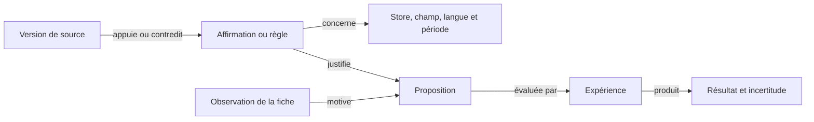

# Architecture de l'alpha

Un monolithe Django modulaire expose une API REST consommée par React et
TypeScript. Les modules partagent une base et des conventions explicites.
Leur séparation ne nécessite pas des microservices au démarrage.

## Cœur et modules

Le cœur gère les comptes, les espaces, les appartenances et le registre.
Chaque module comprend une app Django, un `module.json`, des routes, ses modèles
et éventuellement `frontend/index.tsx`. Le chargement est effectué au déploiement.
L'activation dans un espace ouvre les fonctionnalités déjà installées.

Les dépendances, versions et cycles sont vérifiés au démarrage. Une activation
inclut ses dépendances ; la désactivation d'un module requis est refusée.
L'activation n'exécute pas d'installation Python ou de migration dynamique.
Il n'y a pas de format XML de vues : les vues métier sont des composants React.

Le manifeste distingue `availability: available` (valeur par défaut) de `planned`.
Un module prévu apparaît au catalogue mais ne peut être activé, même par appel API
ou comme dépendance. ASO est disponible avec ses contrôles déterministes Apple.
Les états Enabled/Disabled décrivent l'activation par espace.

La désactivation retire les accès métier sans supprimer les données importées.
Ainsi, désactiver Connections conserve les fiches dans My apps mais bloque leurs
imports et actualisations. L'interface relit les activations au retour sur un
onglet. Le worker Studio vérifie aussi l'activation sous le verrou de l'espace
avant de démarrer une génération en attente : si Studio est désactivé, elle échoue
sans appeler le fournisseur. Une tâche déjà commencée peut finir ; la désactivation
ne constitue pas une annulation d'un appel externe en cours.

## Données et droits

`User → Membership → Workspace → MobileApp → MetadataSnapshot`

`MobileApp → Brief → GenerationRun → Creative`

Un utilisateur peut appartenir à plusieurs espaces. Les rôles sont owner,
editor et viewer. Seul owner gère les modules et connexions ; viewer ne modifie pas de données.
Toutes les routes métier contrôlent l'appartenance, le rôle et le module actif.
Les UUID ne constituent pas un mécanisme d'autorisation. L'administration Django
est réservée aux administrateurs de l'installation, avec visibilité globale.
L'alpha ne possède pas encore d'interface d'invitation ou de création d'espaces ;
leur administration passe par Django admin ou les commandes Django.

L'isolation s'effectue au niveau applicatif, pas par une base distincte par
client ni par des politiques PostgreSQL RLS. Un module Python installé est du
code de confiance ayant accès au processus et à la base. Le registre n'est pas
une sandbox pour du code tiers malveillant.

## Import et génération

Le connecteur démo fournit des données locales explicitement fictives. Un import
met à jour l'app et crée un instantané si la dernière version diffère. Réimporter
le même contenu à la suite ne le duplique pas ; revenir à une ancienne version
crée un nouvel instantané chronologique.

Le module Apple conserve `Workspace → AppleConnection → AppleAppBinding → MobileApp`.
Chaque connexion possède une clé API chiffrée par l'installation et une révision.
L'appel réseau précède la transaction d'import ; les verrous et la révision empêchent
un import de recréer une connexion supprimée ou d'enregistrer des résultats avec
une clé remplacée. Déconnecter conserve les apps et instantanés mais retire leurs
liens de synchronisation. Les requêtes sont exclusivement GET vers l'API Apple.
Le client vérifie les pages suivantes et limite les délais, tailles et requêtes.
Le connecteur reste synchrone ; les gros imports et tâches planifiées viendront ensuite.

Une génération enregistre le brief et les métadonnées utilisés avant de lancer
la tâche. Le couple espace/request_id protège contre les requêtes répétées ;
une réutilisation avec des entrées différentes donne HTTP 409. La tâche verrouille
son état et ne recrée pas les variantes après une seconde livraison normale.
Les états incluent queued, running, canceling, succeeded, canceled et failed.
Les erreurs sont enregistrées ; le workflow lié fournit l’état de référence.

En local, `run_workflows` traite les tâches depuis la base ; Compose utilise
Redis et Celery. Les exécutions possèdent un bail et un heartbeat. Un worker
interrompu perd le droit d’enregistrer un résultat après expiration de son bail.
Le suivi et le worker local détectent les baux expirés ; la reprise est explicite.

Les trois scripts proviennent de modèles de rédaction déterministes.
Ils sont éditables et exportables. Une modification invalide leur approbation,
même si un client envoie une approbation dans la même requête. Il n'existe encore
ni appel IA dans Studio, ni agent navigateur, ni publication automatique.

## Évolutions prévues

L'audit ASO précède la création de scripts. Ses règles vérifiables par code restent
distinctes des appréciations éditoriales assistées par IA ; chacune conserve sa
source officielle et sa date. Les scripts référencent l'instantané audité de la
fiche, afin que les corrections et les générations restent traçables.

Le socle `panda_store.ai` propose OpenAI (Responses + JSON Schema), Google Gemini
(generateContent + JSON Schema) et Anthropic Claude (outil de réponse structuré).
`AIConnection` conserve la clé chiffrée et un catalogue par fournisseur/espace.
Seul le propriétaire peut connecter, remplacer, actualiser ou retirer une connexion.
Les membres lisent uniquement l’état et le catalogue. Les modèles textuels sont filtrés
par famille ; leur disponibilité effective est confirmée à l’appel, sans repli automatique.
Les endpoints et hôtes sont fixes ; délais et taille des réponses sont bornés. Les erreurs
sont traduites en messages contrôlés sans réponse fournisseur brute ni clé.

La validation réseau des clés précède la transaction de sauvegarde. Un verrou sur
l’espace et une révision attendue empêchent de ressusciter une connexion supprimée
ou d’écraser un remplacement concurrent. Les clés d’environnement ne deviennent pas
implicitement accessibles à tous les espaces. L’interface ASO choisit explicitement
le modèle pour chaque analyse ; il n’existe pas encore de préférence de modèle durable.

Pour Gemini, le catalogue conserve aussi la capacité `thinking` déclarée par l’API
(absente = inconnue). Le module ASO fournit une sélection courte au composant commun :
Gemini 3.8 Flash et Gemini 4 Argon, versions stables avec raisonnement et sortie structurée
selon les fiches Google relues le 16 octobre 2026. Elle est intersectée avec le catalogue
de la clé de chaque espace et exige `thinking: true`. Aucun modèle n’est choisi automatiquement.
« Show other models » donne accès aux autres modèles compatibles, dont les versions Lite,
preview et alias mobiles. Les anciennes connexions doivent actualiser leur catalogue pour
obtenir la nouvelle capacité. Une clé sans modèle suggéré peut toujours afficher les autres.
Cette sélection est un conseil de départ, pas un classement mesuré de qualité ASO ; elle
appartient au module et doit être révisée à l’évolution des modèles.

L’adaptateur envoie explicitement `thinkingLevel: medium` aux deux modèles suggérés,
conformément au défaut documenté ; ce paramètre est obligatoire pour Gemini 4.
La limite de 6 000 tokens inclut le raisonnement et peut interrompre une réponse :
l’analyse échoue alors explicitement sans enregistrer une proposition incomplète ni
relancer un appel payant automatiquement. Les autres modèles gardent leurs réglages
fournisseur par défaut ; notamment, supporter le raisonnement ne signifie pas l’activer
par défaut sur toutes les versions Lite.
Sources : [catalogue Google](https://ai.google.dev/gemini-api/docs/models),
[capacité thinking](https://ai.google.dev/api/models),
[réglages du raisonnement](https://ai.google.dev/gemini-api/docs/generate-content/thinking).

Les futurs agents devront conserver les sources et dates de leurs observations,
les actions effectuées et les coûts. Les connecteurs de stores et réseaux
sociaux auront des interfaces séparées. La veille et la génération peuvent
s'exécuter en tâches ; une publication nécessitera un contenu validé, une
destination explicite et un mécanisme de reprise idempotent.

Les quotas, budgets IA, stockage durable des médias,
facturation et opérations cloud ne font pas partie de cette alpha.

## Workflows et événements d'exécution

Le socle `panda_store.workflows` est partagé, avec une première intégration dans
Studio. `WorkflowRun`, `StepRun` et `RunEvent` conservent la définition versionnée,
les dépendances, les états, les dates et les événements ordonnés. Studio fige
l'instantané, le brief et le fournisseur dans `GenerationRun`. Les anciennes
générations restent lisibles sans inventer d'événements historiques.

Le parcours actuel est séquentiel : lire les métadonnées et le brief, produire
les trois modèles de scripts, puis les enregistrer pour revue. Un contrat de
module déclare ses étapes et un adaptateur `workflow.RUNNERS` associe une clé et
une version à son exécuteur. Les dépendances sont vérifiées à la création ; le
worker local charge seulement les adaptateurs des packages déjà installés dans
le registre. Le code des modules conserve le modèle de confiance existant.

Les transitions et événements sont enregistrés dans une même transaction sous
verrou de l'exécution. Un jeton de bail protège les écritures contre un worker
ancien ou annulé. Le heartbeat prolonge un bail de 45 secondes toutes les dix
secondes. Une tâche en attente depuis plus de cinq minutes est marquée en échec
lors de sa consultation, avec une indication pour démarrer le worker. Les clients
actifs et le worker local détectent les baux expirés ; il n'existe pas encore de
superviseur périodique autonome pour les exécutions Celery non consultées.

Les routes communes `/api/workspaces/{id}/workflows/{run}/` et `events/` fournissent
respectivement un état paginé et un flux SSE authentifié. Elles vérifient espace,
appartenance et activation du module. Le flux réévalue les accès à chaque lot,
accepte `Last-Event-ID` et conserve des événements ordonnés en base. Il dure au plus
25 secondes ; EventSource se reconnecte, avec polling de secours côté React.
Uvicorn/ASGI et Nginx sans buffering sont configurés pour Compose. Le backend
utilise `CONN_MAX_AGE=0` et les threads de heartbeat ferment leurs connexions à
la sortie. Ce réglage suit les [recommandations Django pour ASGI](https://docs.djangoproject.com/en/5.2/topics/async/#queries-the-orm).
Le serveur
WSGI de développement reste compatible avec un flux synchrone borné. Une coupure
du flux est signalée séparément de l'échec de la tâche.

`Stop` annule immédiatement une tâche en file ou demande un arrêt coopératif
(`canceling`) si elle travaille. La fin de l'appel courant est attendue ; son
résultat est écarté si le bail ou le statut ne l'autorise plus. La sauvegarde des
scripts et la réussite du workflow sont atomiques. Un arrêt ne défait pas une
publication externe et le Studio actuel n'en effectue aucune.

`Retry unfinished steps` crée une tentative liée, conserve la précédente et
réutilise les checkpoints terminés lorsque version, étapes et dépendances
correspondent. Studio reprend les entrées originales, même si la fiche ou le
brief ont changé depuis. Une seule reprise par tentative rend les doubles clics
idempotents. Les checkpoints internes ne sont pas exposés dans l'API d'activité ;
les messages sont des résumés contrôlés, jamais des réponses brutes du fournisseur.
Les scripts produits restent soumis à leur approbation séparée existante.

Le panneau React commun présente les étapes cliquables, leur durée réelle, un
journal horodaté et les commandes permises par le rôle. Il reprend les événements
sans doublons et retire les données si l'accès est révoqué. Il n'allonge pas
artificiellement une génération courte pour simuler une activité d'agent.

Les tests couvrent arrêt en file et pendant un outil, résultats tardifs, reprise
sans nouvelle génération des résultats sauvegardés, curseurs et reconnexion,
accès révoqués, panne de dispatch, worker expiré et flux ASGI. Les doubles
livraisons concurrentes sont aussi vérifiées sur PostgreSQL en CI.

Restent à construire : agents IA et navigateur, ordonnanceur de branches
parallèles, validation humaine suspendant un workflow, contrats de progression
quantifiée et de médias privés, éditeur visuel et supervision autonome de toutes
les tâches. Chaque connecteur avec effets externes devra ajouter idempotence et
réconciliation. Les URLs, captures et coûts seront exposés seulement lorsque
les outils concernés les auront réellement produits.

## Conception de l'agent ASO spécialisé

Le module disponible réalise les contrôles locaux de métadonnées Apple, avec
historique par langue et suivi du workflow commun. `AuditRun` conserve l'import,
la version des règles et le rapport ; les contrôles déterministes restent locaux.
Chaque contrôle conserve ses références et leur date de revue. Le champ
`available_fields` des nouveaux imports distingue une absence de donnée d'une
valeur vide. Les imports antérieurs utilisent uniquement les champs présents.
Une langue absente ne bénéficie jamais d'un repli implicite sur la langue principale.
La reprise garde l'import original ; changer les règles impose de changer leur
version et celle du workflow. Un rapport sauvegardé n'est pas recalculé à la lecture.

La suite de cette section décrit l'agent à implémenter. Le
[catalogue de sources](../addons/aso/knowledge/sources.json) est une sélection relue,
avec usages et limites ; les contrôles actuels utilisent uniquement les sources Apple.
Ce n'est pas encore un corpus indexé ou un agent IA.

### Revue éditoriale implémentée

Le workflow optionnel `aso.editorial` ajoute une requête IA et une validation après
les règles locales. `AuditRun.inputs` fige fournisseur, modèle demandé, identifiant
et révision de connexion, version d’instructions et annotations Apple sourcées.
Le rapport conserve le modèle résolu et les tokens retournés. Les checkpoints de
réponse et de validation permettent une reprise sans rappeler un modèle ayant déjà
répondu. Une réponse perdue avant sauvegarde peut être facturée à nouveau lors d’une
reprise explicite ; aucune garantie d’exactly-once sur l’API tierce n’est annoncée.
Le heartbeat maintient le bail pendant le réseau. Annuler écarte les résultats tardifs
mais n’annule pas une facture déjà engagée. Retirer/remplacer la clé avant l’appel
fait échouer cette tentative, sans basculer vers une autre clé ou un autre fournisseur.

La validation impose langue disponible, champs supportés, citations présentes dans
l’import, références autorisées, limites de texte, absence de doublons, nouveaux
nombres ou changements d’URLs. Elle ne prouve pas la fidélité des promesses, la bonne
interprétation des sources ou la valeur commerciale : toutes les propositions IA
sont marquées hypothèses à relire. Elles peuvent alimenter un brouillon, jamais
écrire chez Apple. Les règles, l’activité et le rapport historique restent distincts.
Le corpus actuel est constitué d’annotations originales sur deux guides Apple ;
les blogs sélectionnés, la recherche, le graphe et les images restent hors de ce parcours.

Références d’implémentation : [OpenAI Structured Outputs](https://developers.openai.com/api/docs/guides/structured-outputs),
[Gemini generateContent](https://ai.google.dev/api/generate-content),
[Claude Messages](https://platform.claude.com/docs/en/api/messages/create).

### Brouillons implémentés

`ListingDraft` conserve une référence importée immuable, une langue, le contenu
éditable et les propositions sources sélectionnées. Un brouillon peut venir d'un
import, d'une proposition d'audit terminée ou d'une copie nommée d'un brouillon.
`DraftRevision` conserve chaque sauvegarde, son auteur, sa raison et son contenu.
Les mutations exigent la version attendue et un identifiant de requête : un conflit
retourne 409 ; rejouer la même requête ne crée pas une seconde révision. Le verrou
de l'espace puis celui du brouillon sérialisent les mutations sur PostgreSQL.

La sauvegarde différée du frontend ne remplace pas les frappes intervenues pendant
une requête. Un garde de navigation attend la sauvegarde avant de changer de module,
d'app, d'espace ou de se déconnecter. En cas d'échec, le texte reste à l'écran avec
une action de reprise ; en cas de conflit, on peut le copier puis charger la version
enregistrée. Le statut `ready` exige une action séparée et des limites de champs
résolues, y compris la divergence octets/caractères ; une modification le réinitialise.

La comparaison lit le dernier import de la langue exacte, sans repli ni réécriture
du brouillon. L'actualisation Apple passe par le connecteur existant et ses contrôles
de droits/activation. Les champs modifiés peuvent correspondre au dernier import,
sans changement de statut de revue et sans déduction de publication ou de performance.
Les exports texte utilisent une révision explicite. Aucun endpoint ne publie sur Apple.

### Connaissances et preuves

La spécialisation doit couvrir découverte, intentions de recherche, mots-clés,
conversion, visuels, localisation, avis, expérimentation et mesure. Elle repose sur
des outils métier, des sources consultables et des évaluations. Une connaissance
du modèle seul ne suffit pas à justifier une règle, statistique ou promesse produit.

Les sources sont sélectionnées au niveau de l'article et de l'affirmation :

- Apple et Google : exigences et recommandations classées séparément, avec leur portée.
- Phiture / ASO Stack : cadre de travail et méthodes de praticiens.
- AppTweak : recherche de mots-clés et distinction entre observations, données de
  comptes connectés et estimations propriétaires.
- SplitMetrics : conception d'expériences et cas clients contextualisés. Un test
  sur une page simulée avec trafic publicitaire n'est pas une mesure native
  d'installations organiques.
- Fiches de grandes apps et concurrents comparables : observations datées, sans
  prétendre connaître leurs taux de conversion ou mots-clés privés.
- Données et expériences de l'app : résultats isolés par workspace et liés à un instantané.

La réputation d'une société n'approuve pas toutes ses affirmations. Conserver
éditeur, auteur disponible, URL, dates, store, pays, langue, contexte, type de preuve
et limites. Les résultats commerciaux restent attribués à leur auteur. Les chiffres
sans méthode et contradictions restent à vérifier. Une référence ancienne peut
illustrer une méthode sans décrire les stores actuels. Un article inaccessible
n'est jamais résumé comme s'il avait été lu.

Le catalogue distribué contient liens et annotations originales. L'indexation
future respecte les autorisations d'accès et de réutilisation ; aucune copie
intégrale de blogs tiers n'est redistribuée. Les règles évoluent avec historique.

### Graphe de connaissances et recherche documentaire

Le graphe proposé relie chaque proposition à ses preuves :

Des tables Django compatibles SQLite et PostgreSQL suffisent pour commencer ;
aucun service de graphe supplémentaire n'est obligatoire pour l'auto-hébergement.
Chaque relation conserve origine, portée et statut de vérification. Une proximité
sémantique n'est pas une relation causale. Les liens proposés par l'IA doivent être
vérifiés avant leur utilisation comme preuve.

La recherche filtre d'abord par store, langue, marché, période et fonctionnalité,
puis retrouve les documents et suit les liens vers les sources, contradictions et
expériences applicables. Recherche textuelle puis sémantique facultative : les
embeddings ne remplacent pas les filtres et preuves. Les concepts sont réutilisables ;
les résultats privés restent limités au workspace. Les apports communautaires passent
par revue des sources et tests et ne deviennent pas des instructions exécutables.

### Exécution et validation

Vérifier d'abord la couverture : version, langues, captures par langue et appareil,
marché cible, fonctions confirmées et statistiques disponibles. L'import actuel
ne couvre que les captures de la langue principale ; une autre langue non importée
ne prouve donc pas un défaut de la fiche.

Le parcours prévu : collecte, contrôles déterministes, recherche documentaire et
concurrentielle, propositions contextualisées, validation, protocole de mesure.
Les contrôles déterministes fonctionnent sans clé IA ; l'analyse éditoriale utilise
le fournisseur et modèle choisis. Les pages et documents sont des données non
fiables, jamais des instructions pour l'agent.

Une proposition conserve l'instantané, le champ, le constat, les références exactes,
le remplacement, les conditions d'application, le statut (correction vérifiable,
hypothèse à tester ou données insuffisantes) et la méthode de validation. Le validateur
rejette références inexistantes, contraintes dépassées, fonctions inventées et
statistiques sans source. Il distingue pertinence d'un terme, demande mesurée et
estimation tierce. Les connecteurs de données payants restent facultatifs.

Avant activation, évaluer sur des cas relus par un humain : fiches correctes sans
correction forcée, données incomplètes, stores différents, langues non couvertes,
sources obsolètes ou contradictoires, absence de statistiques, promesses non
confirmées et contenus tentant de détourner l'agent. Vérifier citations, portée
des règles, utilité des propositions et abstention pour chaque fournisseur.
Les évaluations du modèle ne remplacent pas la mesure des gains sur le store.
